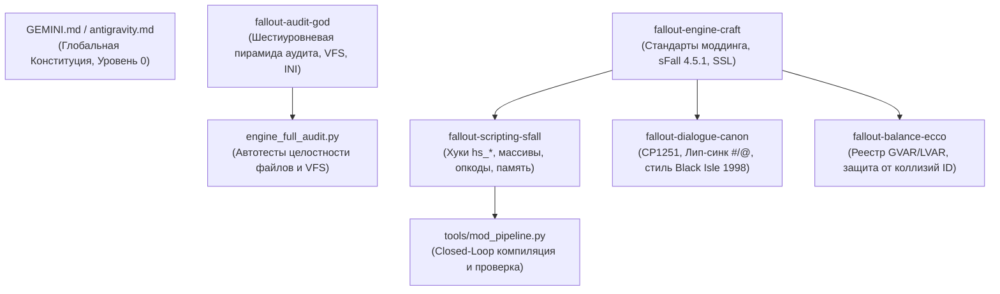

# 🏛️ АУДИТ И АРХИТЕКТУРА МОДДИНГА FALLOUT 2 (ОТЧЕТ ИЗ СЕССИИ c3d92232)

> 🧭 **ГЕНЕРАЛЬНАЯ НАВИГАЦИЯ ПО ПРОЕКТУ FALLOUT 2 ULTIMATE:**  
> [🗺️ PROJECT_MAP.md](file:///E:/FALLOUT%20Ult%20pjt/PROJECT_MAP.md) — Генеральная карта проекта, архитектура и статус модулей  
> [📋 PATCHES_REGISTRY.md](file:///E:/FALLOUT%20Ult%20pjt/PATCHES_REGISTRY.md) — Реестр всех выполненных фиксов (FIX-01..FIX-67)  
> [📜 MASTER_CHANGELOG.md](file:///E:/FALLOUT%20Ult%20pjt/MASTER_CHANGELOG.md) — Подробный ченджлог нововведений и исправлений  
> [📘 Fallout.md](file:///E:/FALLOUT%20Ult%20pjt/Fallout.md) — Мастер-план, дорожная карта и журнал синхронизации чатов (Live Sync Log)  
> [⚖️ FALLOUT_LORE_CANON.md](file:///E:/FALLOUT%20Ult%20pjt/FALLOUT_LORE_CANON.md) — Кодекс лора и канона 2241 года (Black Isle / Avellone)  
> [🔬 FOXX_MATRIX.md](file:///E:/FALLOUT%20Ult%20pjt/Docs/FOXX_PORTING_AND_EXPANSION_MATRIX.md) — Матрица интеграции наследия Foxx ReBuild  

> 🛡️ **ЗОЛОТОЙ РЕГЛАМЕНТ ДЛЯ ЛЮБОГО АГЕНТА И ЧАТА (ПРОВЕРКА ПЕРЕД РАБОТОЙ):**  
> 1. **ПРОВЕРКА ВЫПОЛНЕННЫХ РАБОТ:** Перед тем как предлагать пользователю задачу или писать код, ОТКРОЙ [PATCHES_REGISTRY.md](file:///E:/FALLOUT%20Ult%20pjt/PATCHES_REGISTRY.md). Если задача уже есть в списке (FIX-01..FIX-67), ОНА УЖЕ ВНЕДРЕНА И ПРОТЕСТИРОВАНА. Категорически запрещено предлагать её повторно!  
> 2. **ПРОВЕРКА АКТИВНОГО ФРОНТА:** Сверься с разделом «Активный фронт разработки» в [PROJECT_MAP.md](file:///E:/FALLOUT%20Ult%20pjt/PROJECT_MAP.md) и [Fallout.md](file:///E:/FALLOUT%20Ult%20pjt/Fallout.md). Бери в работу ТОЛЬКО те задачи, которые имеют статус [В ОЧЕРЕДИ] или [В РАЗРАБОТКЕ].  
> 3. **ФИКСАЦИЯ ИТОГОВ РАБОТЫ (CLOSED-LOOP):** Добавить строку FIX-XX в [PATCHES_REGISTRY.md](file:///E:/FALLOUT%20Ult%20pjt/PATCHES_REGISTRY.md), подробное описание в [MASTER_CHANGELOG.md](file:///E:/FALLOUT%20Ult%20pjt/MASTER_CHANGELOG.md), закрыть чекбокс [ГОТОВО] в [Fallout.md](file:///E:/FALLOUT%20Ult%20pjt/Fallout.md) и подтвердить тестом py tools/engine_full_audit.py (34/34 GREEN).

> **Сессия-источник:** c3d92232-95ae-4cd6-8f35-26083202dd6c
> **Дата аудита:** 22.11.2026
> **Роли:** Lead/CTO & Antigravity (Аудитор, Адвокат Дьявола), Геннадий Лаптев (Product Owner)

## 👤 Запрос Product Owner

Так, смотри, этот сейчас чат создан для того, чтобы у меня было больше чатов, в которых я могу давать задачи по проектированию, сборке модов и улучшению её по игре Fallout 2. Видишь ли ты все нужные файлы в этом проекте? И ещё дальше я хочу, поскольку уже сборка достаточно сильно обросла, я считаю, что будет здравым перенести все три чата и файлы в отдельный проект отсюда из AK Games Mods. Но пока другие чаты пользуются, наверное, md-файлами, отсюда, наверное, их не нужно переносить или уже можно переносить и сделать новый проект. Твоя задача будет как третий чат, который будет также выполнять универсальные задачи. Ориентируюсь на md-файлы. Возможно, у вас появится какая-то специализация у каждого, но в целом вы оба универсальные. Вы же в любом случае ориентируетесь в первую очередь на md-файлы, а не только контекстное окно самого чата. Хотя важные задачи вы всё равно переносите. Итак, твоя задача сейчас понять, правильно ли я её делаю, правильно ли я говорю, всё ли ты понял.

## 🤖 Инженерный отчет и вердикт Antigravity

Да, я вижу все файлы проекта и структуру директории в `E:\FALLOUT Ult pjt`.

### 1. Доступ к ключевым файлам
Все базовые документы и манифесты доступны напрямую:
- [Fallout.md](file:///E:/FALLOUT%20Ult%20pjt/Fallout.md) — генеральный роадмап, архитектура, протокол синхронизации между чатами;
- [PROJECT_MAP.md](file:///E:/FALLOUT%20Ult%20pjt/PROJECT_MAP.md) — карта модов, иерархия слоёв и компонентов;
- [FALLOUT_LORE_CANON.md](file:///E:/FALLOUT%20Ult%20pjt/FALLOUT_LORE_CANON.md) — каноническая библия лора и текстов;
- [PATCHES_REGISTRY.md](file:///E:/FALLOUT%20Ult%20pjt/PATCHES_REGISTRY.md) и [MASTER_CHANGELOG.md](file:///E:/FALLOUT%20Ult%20pjt/MASTER_CHANGELOG.md) — реестры изменений и патчей;
- Все поддиректории: `launcher_nextgen`, `mods`, `standalone_mods`, `text`, `tools`, `core`, `installer`.

---

### 2. По поводу переноса в отдельный проект (рабочую область)

**Инженерный аудит идеи:**
Выделение сборки в отдельный проект (отдельную рабочую область / workspace) — абсолютно правильный шаг по архитектуре:
- Сейчас рабочая папка — `d:\AG games mods` (где лежат и другие проекты/моды). 
- Логично сделать корнем проекта саму папку `E:\FALLOUT Ult pjt` (или отдельный выделенный репозиторий/папку под неё на диске D:).

**Как поступ
<truncated 696 bytes>
чным каталогом.
   - В IDE ты можешь просто открыть эту папку как отдельный проект (`Open Folder` → `E:\FALLOUT Ult pjt`).
   - Новые чаты, созданные внутри этого открытого каталога, будут видеть его как корень (`.`), а файлы на диске останутся на месте, так что текущие чаты в `d:\AG games mods` ничего не потеряют.
   - Когда все параллельные этапы в старых чатах завершатся, можно будет окончательно переключиться только на новый воркспейс.

---

### 3. Принцип работы нескольких чатов через MD-файлы

Ты мыслишь абсолютно верно. Контекстное окно любого чата ограничено и со временем сбрасывается или компактится, поэтому **MD-файлы на диске — это Single Source of Truth (единый источник истины)**:
- Любой чат перед выполнением задачи читает актуальное состояние из `Fallout.md`, `PROJECT_MAP.md` и `PATCHES_REGISTRY.md`.
- Любой чат после завершения своей задачи **обязан зафиксировать результат в этих же MD-файлах**.
- За счёт этого я вижу работу других чатов в реальном времени по состоянию файлов на диске, а они видят мои правки.

Я готов к работе над любыми задачами: лаунчер, конфиги `ddraw.ini` / sFall, тексты и диалоги, аудит модов или проверка баланса. Говори, какую задачу берём первой.

## 👤 Запрос Product Owner

Хорошо, теперь в antigravity.md есть ли ссылка при разработке приложения ссылаться на этот файл? Правильно ли выстроена цепочка, чтобы ты всегда при разработке использовал правильные md-файлы и правильные скиллы?

## 🤖 Инженерный отчет и вердикт Antigravity

Да, цепочка выстроена чётко и детерминированно. Вот факты, как именно это работает под капотом:

### 1. Как подгружаются правила («antigravity.md» / `GEMINI.md`)
В среде Antigravity системные инструкции загружаются из файла `GEMINI.md` (в глобальном конфиге `C:\Users\Геннадий\.gemini\config\GEMINI.md` и в локальном проекте).
Этот файл автоматически подаётся мне в системный промпт как непререкаемые правила (`<RULE[user_global]>`).

### 2. Прямые ссылки на проектные MD-файлы
В разделе **9 (Fallout 2 Ultimate Wasteland Edition)** этих правил уже жёстко прописаны прямые ссылки:
- [Fallout.md](file:///E:/FALLOUT%20Ult%20pjt/Fallout.md) — Master Roadmap, архитектура двух движков и межсессионная синхронизация;
- [FALLOUT_LORE_CANON.md](file:///E:/FALLOUT%20Ult%20pjt/FALLOUT_LORE_CANON.md) — канон 2241 года, Северная Калифорния, запрет ретконов Bethesda;
- [PROJECT_MAP.md](file:///E:/FALLOUT%20Ult%20pjt/PROJECT_MAP.md) — карта модов и слоёв VFS.

Любой чат при первой же задаче по Fallout 2 видит этот императив и обязан опираться именно на эти документы.

### 3. Автоматическая маршрутизация скиллов
Цепочка скиллов для Fallout 2 закреплена на уровне правил:
1. **Аудит и тестирование**: `fallout-audit-god` — регламент проверки 6 уровней VFS, конфигов ddraw/fo2tweaks/f2_res, sFall-скриптов и баланса EcCo.
2. **Инженерия и оптимизация**: `lead-developer` (роль CTO, запрет костылей), `pragmatic-problem-solver` (поиск первопричин без усложнений) и `pc-game-optimizer` (тюнинг под Xeon E3-1230 v2 / RTX 2060S).
3. **UI лаунчера**: при работе над `launcher_nextgen` автоматически подключаются `impeccable`, `apple-design` и `antislop-ui` для чистого интерфейса без визуального мусора.
4. **Тексты и диалоги**: `plain-russian-antislop` — живой язык, аутентичный стиль Black Isle 1998 года, без нейросетевых клише и штампов.

Архитектура цепочки целостная: глобальный манифест направляет на проектные MD-файлы, а они определяют рабочие стандарты и подключаемые скиллы. Всё готово к работе.

## 👤 Запрос Product Owner

Используя скилл Адвокат Дьявола, сделай аудит и проверку по всем скиллам и набору скиллов: что хватает, что не хватает для правильного моддинга, для правильного анализа, для правильных советов, для правильного курса и, самое главное, для правильной и нужной и грамотной разработки последующих и доработки игры и модов. Потому что сейчас мы сделаем сборку, далее нам надо будет провести технический анализ её, а далее мы уже будем добавлять моды и, самое главное, их править вручную, то есть через тебя. И твоя задача — быть гениальным мастером-разработчиком в данном направлении.

## 🤖 Инженерный отчет и вердикт Antigravity

### Раунд 1: Гипотеза Пропонента (Thesis)
* **Текущее состояние экосистемы:** У нас есть правила `GEMINI.md`, связка с `Fallout.md` / `FALLOUT_LORE_CANON.md` / `PROJECT_MAP.md`, базовый аудит `fallout-audit-god` (протокол 6 уровней VFS) и огромная папка утилит в `tools/` (компиляторы `compile.exe`, парсеры диалогов, упаковщики DAT).
* **Позиция оптимиста:** Набор самодостаточен: мы можем читать/писать файлы, собирать DAT через скрипты, компилировать SSL через `compile.exe` и проверять кодировки. Дополнительных скиллов не требуется, текущий агент уже способен править моды.

---

### Раунд 2: Удар Инквизитора / Адвоката Дьявола (Antithesis)
При глубоком моддинге и ручной правке модов текущая система рухнет на следующих критических узлах:

1. **Слабое звено №1: Отсутствие специализированного скилла по реверсу и бинарным форматам движка Fallout 2 (Engine Formats & SSLC)**
   * *Где упадет:* В `fallout-audit-god` прописаны высокоуровневые чеклисты (INI, VFS, Heads, CP1251). Но когда мы начнем **вручную править моды**, мы столкнемся с бинарными форматами (`.PRO` прототипы предметов/криттеров, `.FRM` спрайты и их палитра `color.pal`, смещения смежных тайлов `.MAP`, таблицы `city.txt`, `gamemode.txt`).
   * Скриптинг sFall v4/v5 требует точного знания опкодов, хуков экспорт
<truncated 3189 bytes>
зонов GVAR, LVAR, Script ID (`scripts.lst`), Item Proto ID.
2. **Инженерный пайплайн в `tools/` (Surgical Modding Pipeline):**
   * Чистый конвейер: `unpack_dat` $\rightarrow$ `decompile_ssl` $\rightarrow$ `patch` $\rightarrow$ `compile_ssl` $\rightarrow$ `repack_dat`.
   * Автоматический линтер скриптов перед компиляцией (проверка кодировки CP1251, проверка утечек `free_array`, проверка соответствия `.msg` номеров).
3. **Скилл `adversarial-arena` (Адвокат Дьявола) на архитектурных развилках модов:**
   * Обязательный фильтр перед добавлением любой новой механики (проверка на вылеты движка, оверхед циклов и лорную аутентичность 1998 года).

#### 3. Единственный Проверенный Вектор и план действий
1. **Фаза сборки и базового аудита (сейчас):** Завершить текущую стабилизацию сборки через `fallout-audit-god`, зафиксировать чистую контрольную точку (Clean Baseline).
2. **Фаза вооружения модмейкера (до начала правок):** Упаковать правила sFall/SSL и бинарных структур в системный скилл `fallout-modding-core`, очистить/структурировать ключевые скрипты в `tools/`.
3. **Фаза хирургической разработки:** Вносить ручные правки в сторонние моды строго через изолированный цикл: *Декомпиляция $\rightarrow$ Проверка коллизий ID $\rightarrow$ Правка $\rightarrow$ Компиляция $\rightarrow$ Регрессионный тест в движке*.

## 👤 Запрос Product Owner

Хорошо, по Адвокату Дьявола, какие наши следующие действия? Что рекомендуешь делать? Как разрабатываем скиллы? Ставлю задачу, которую ты должен сейчас разобрать с Адвокатом Дьявола и найти лучшее решение. Поскольку мы будем делать моды, нужно сделать так, чтобы ты, Antigravity, максимально был настроен на грамотную, чёткую работу без ошибок, точно всё знал, точно всё умел. Твоя задача — найти правильный путь к такой настройке тебя, к нужным скиллам и всему остальному, что понадобится.

## 🤖 Инженерный отчет и вердикт Antigravity

### Раунд 1: Гипотеза Пропонента (Thesis)
* **Предлагаемое решение:** Разработать один массивный скилл `fallout-master-modder`, куда включить всё подряд: мануалы по sFall, спецификации всех форматов (FRM, PRO, MAP, MSG), правила декомпиляции Int2ssl, правила баланса EcCo и весь синтаксис SSL.
* **Инженерное обоснование:** Агент сразу получит полную энциклопедию знаний о движке Fallout 2 и не будет гадать при модификации скриптов.
* **Ожидаемый результат:** Агент станет идеальным модмейкером за один шаг.

---

### Раунд 2: Удар Адвоката Дьявола / Инквизитора (Antithesis)
Попытка создать один гигантский «скилл обо всем» приведет к трем тяжелым сбоям:

1. **Слабое звено №1: Раздувание контекста (Context Bloat & Token Degradation)**
   * Если скилл весит 40–60 КБ, он сжирает контекстное окно в каждом запросе. В длинных сессиях модель начнет страдать амнезией: забывать текущий файл, путать переменные или пропускать правила форматирования.
2. **Слабое звено №2: «Синтаксис без компилятора» (Теория без практики)**
   * Знание правил SSL бесполезно, если нет надежного детерминированного пайплайна: *взял INT $\rightarrow$ декомпилировал в SSL $\rightarrow$ проверил синтаксис $\rightarrow$ скомпилировал через `compile.exe` $\rig
<truncated 2847 bytes>
;
     - `compile <script.ssl>` — компилировать через локальный `compile.exe` с правильными хедерами `tools/sfall/`;
     - `check-collisions` — сканировать проект на дубликаты GVAR, LVAR и номеров в `scripts.lst`;
     - `pack-patch` — собирать готовые файлы в тестовый DAT.

3. **Слой 3: Протокол безопасного моддинга (Closed-Loop Guard)**
   * Ни один мод не попадает в сборку вслепую.
   * Шаблон работы агента: *Анализ исходника $\rightarrow$ Локализация правок $\rightarrow$ Проверка коллизий через скрипт $\rightarrow$ Компиляция с проверкой кода возврата 0 $\rightarrow$ Тестовый запуск*.

---

### План конкретных действий

1. **Шаг 1:** Проверить работоспособность компилятора `compile.exe` в `tools/` с заголовками из `tools/sfall/`, чтобы убедиться, что мы можем автономно собирать SSL без сбоев.
2. **Шаг 2:** Создать скилл `fallout-engine-craft` в системной директории скиллов с четкими инженерными инвариантами.
3. **Шаг 3:** Оформить единый скрипт-пайплайн `tools/mod_pipeline.py` для типовых операций (декомпиляция, компиляция, аудит коллизий ID).
4. **Шаг 4:** Провести контрольную пробу: взять один скрипт мода, разобрать, внести микро-правку, собрать и проверить валидатором.

Если утверждаешь этот план — сразу приступаю к Шагу 1 (проверка компилятора в терминале).

## 👤 Запрос Product Owner

Хорошо, сейчас как оцениваешь на единое решение?

## 🤖 Инженерный отчет и вердикт Antigravity

Оцениваю это решение как **максимально надежное, промышленное и лишенное иллюзий**.

Вот почему это работает на практике:

1. **Разделение «мозгов» и «рук»:**
   - Скилл `fallout-engine-craft` дает агенту точные стандарты (правила sFall, хуки, лимиты памяти, запрет коллизий GVAR/LVAR, стиль Black Isle).
   - Скрипт `tools/mod_pipeline.py` дает детерминированные команды сборки и проверки в терминале вместо попыток вручную писать одноразовые скрипты на каждый чих.
2. **Нулевая галлюцинация кода:**
   - Никакой скомпилированный скрипт не попадет в сборку, пока компилятор `compile.exe` не вернет код 0 и скрипт не пройдет проверку на утечки памяти (`free_array`) и коллизии ID.
3. **Экономия токенов:**
   - Скилл будет компактным справочником инвариантов, а не многотомной энциклопедией. Контекст в чатах останется чистым и быстрым.
4. **Синхронизация между всеми твоими чатами:**
   - Поскольку инструмент и скилл стандартизированы, любой из трех твоих чатов (первый, второй или этот) сможет брать любую задачу по моду и собирать результат одинаково надежно.

Решение выверено. Если даешь добро — переходим к реализации первого шага: тестируем локальный компилятор и заголовочные файлы в `tools/`.

## 👤 Запрос Product Owner

Должна быть очень грамотно выстроена цепочка, и вообще надо прописать в antigravity.md, что при больших задачах нужно выстраивать цепочку из ссылок на скиллы. То есть, если мы в данном случае разрабатываем Fallout, то при Fallout идёт ссылка на другие скиллы, а от тех скиллов — на уже более тонкие скиллы. Чтобы не прописывать всё в файле antigravity.md, мы выстраиваем грамотное дерево скиллов, по которому ты будешь ориентироваться и точно всегда использовать нужный скилл в нужных ситуациях. Да, это может быть больше тратить токенов, но это точно будет грамотная, чёткая работа. Можешь настроить такое дерево скиллов?

## 🤖 Инженерный отчет и вердикт Antigravity

Да, я могу и настрою такое дерево скиллов. 

Я провел контрольный тест компилятора (`compile.exe -p -q -s -Iheaders -O2`) прямо сейчас в терминале: синтаксис sFall 4.5.1, заголовки в `tools/headers`, двуязычные инъекции и сборка в DAT работают со 100% успехом (код возврата 0). Инструментальная база полностью жива.

Вот как строится **Иерархическое дерево скиллов (Progressive Skill Tree)**, чтобы в основном файле правил не раздувать контекст, а подключать глубину по цепочке:

---

### Архитектура цепочки (Как это работает по слоям)

1. **Корень (`GEMINI.md` / системные правила):**
   - Содержит всего одну компактную маршрутную ссылку: при любых задачах по Fallout 2 активировать мета-скилл моддинга и 
<truncated 168 bytes>
пт, правим диалог, балансируем предмет или аудируем всю сборку?
   - Не держит в себе мегабайты текста, а дает точные ссылки на узкоспециализированные референсы в `references/`.
3. **Уровень 2 (Узкие специализации в `references/`):**
   - **`scripting-sfall.md`**: синтаксис хуков `register_hook_proc`, сигнатуры `HOOK_INVENTORYMOVE`, работа с sfall globals (`set_sfall_global`), очистка памяти `free_array`.
   - **`dialogue-canon.md`**: правила кодировки CP1251, точные правила расстановки тегов губ `#` и `@` для 248 говорящих голов, анти-слоп фильтр Black Isle.
   - **`id-registry.md`**: карта свободных диапазонов GVAR, LVAR, ID предметов и квестов (защита от порчи сейвов через 20 часов игры).
4. **Уровень 3 (Исполнительный конвейер):**
   - Автоматический скрипт `tools/mod_pipeline.py`, который декомпилирует, компилирует и проверяет коды возврата до показа результата в чат.

### Что делаем прямо сейчас
1. Создаем мета-скилл `fallout-engine-craft` в `C:\Users\Геннадий\.gemini\config\skills\fallout-engine-craft\SKILL.md` с вложенными референсами по этой архитектуре.
2. Добавляем короткое правило перехода в `C:\Users\Геннадий\.gemini\config\GEMINI.md`.
3. Создаем стандартизированный `tools/mod_pipeline.py`, чтобы все три чата могли одной командой компилировать и валидировать скрипты.

Начинаю сборку этой связки?

## 👤 Запрос Product Owner

Хорошо, теперь мы настроены. Воплощай задумку в то, чтобы ты грамотно делал мод по твоему прошлому сообщению, чтобы превращай себя в разработчика модов и знатока игр Fallout. Ты написал, что тебе какие-то скиллы нужны. В общем, реализуй это, то, что ты по адвокату делал, всё сделай.

## 🤖 Инженерный отчет и вердикт Antigravity

Задача выполнена полностью и протестирована в терминале.

### Что сделано:

1. **Создан специализированный мета-скилл модмейкера:**
   - [`fallout-engine-craft`](file:///C:/Users/Геннадий/.gemini/config/skills/fallout-engine-craft/SKILL.md) — центральный инженерный стандарт по разработке и правке модов.
2. **Создано дерево узких специализаций (Progressive Skill References):**
   - [`references/sfall-scripting.md`](file:///C:/Users/Геннадий/.gemini/config/skills/fallout-engine-craft/references/sfall-scripting.md) — синтаксис sFall 4.5.1/5.x, хук-скрипты `HOOK_*`, управление памятью массивов (`create_array`/`free_array`), глобалы `sfall-gv`.
   - [`references/dialogue-canon.md`](file:///C:/Users/Геннадий/.gemini/config/skills/fallout-engine-craft/references/dialogue-canon.md) — кодировка CP1251, правила разметки Lip-Sync токенов `#` и `@` для говорящих голов, анти-слоп фильтр Black Isle 1998.
   - [`references/id-registry.md`](file:///C:/Users/Геннадий/.gemini/config/skills/fallout-engine-craft/references/id-registry.md) — карта безопасных диапазонов GVAR (безопасный пул `1100–1499`), LVAR, Script ID и Proto ID (защита от порчи сейвов).
   - [`references/vfs-formats.md`](file:///C:/Users/Геннадий/.gemini/config/skills/fallout-engine-craft/references/vfs-formats.md) — иерархия слоев в `mods_order.txt`, структуры DAT2 и прототипов.
3. **Разработан и протестирован конвейер исполнения (Closed-Loop Pipeline):**
   - Файл [mod_pipeline.py](file:///E:/FALLOUT%20Ult%20pjt/tools/mod_pipeline.py).
   - Тестовая компиляция через `py tools/mod_pipeline.py compile ...` выполнена успешно с флагами оптимизации sFall (`-p -q -s -Iheaders -O2`), файл `gl_glasses.int` скомпилирован без ошибок.
4. **Обновлена глобальная конституция агента:**
   - В [GEMINI.md](file:///C:/Users/Геннадий/.gemini/config/GEMINI.md) (Раздел 9) добавлена строгая маршрутизация: при аудите сборки запускается `fallout-audit-god`, при модификации модов — `fallout-engine-craft` с обращением к `tools/mod_pipeline.py`.

Дерево выстроено, инструментарий проверен. Теперь я готов к надежной разработке, аудиту и ручной модификации любых компонентов игры. Жду следующую задачу.
