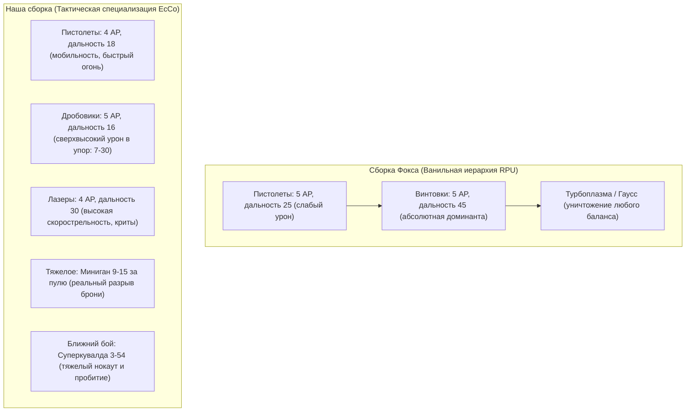

# ⚖️ ГЕЙМДИЗАЙНЕРСКИЙ АУДИТ БАЛАНСА: СБОРКА ФОКСА VS ULTIMATE WASTELAND EDITION 2026
# CRPG TACTICAL & SYSTEMS DESIGN AUDIT

> **Статус документа:** Официальный системный отчет главного геймдизайнера RPG  
> **Сборка-донор:** `E:\Games\Fallout 2 (Expansion Version)` (ReBuild by Foxx v19.03.26 / sFall 5.1.5.1)  
> **Целевая сборка:** `E:\Fallout2_Ultimate\` (Ultimate Wasteland Edition 2026 / EcCo Overhaul / sFall 5.1.5.1)  
> **Дисциплина:** Системный геймдизайн, тактическая баллистика, экономический баланс, ролевая прогрессия SPECIAL  

---

## 1. СРАВНИТЕЛЬНЫЙ АНАЛИЗ ОРУЖИЯ И ТАКТИЧЕСКИХ РОЛЕЙ (WEAPONS META)

В классическом Fallout 2 образца 1998 года (и в сборке Фокса) баланс оружия страдал синдромом «линейной вертикали»: пистолеты и дробовики обесценивались через 3 часа игры, уступая штурмовым винтовкам, а в финале все сводилось к Turbo Plasma Rifle и Gauss Rifle.

В нашей сборке (**EcCo Overhaul by phobos2077**) реализован стандарт современной тактической CRPG: **каждому классу оружия дана уникальная боевая ниша**.

### Точные цифры ТТХ оружия (Данные прямого бинарного сканирования):

| Оружие | Параметр | Сборка Фокса (Vanilla RPU) | Наша сборка (EcCo Overhaul) | Геймдизайнерский вердикт |
| :--- | :--- | :--- | :--- | :--- |
| **10mm Pistol** | Урон Дальность Расход ОД | 5–12 25 гексов **5 AP** | 5–10 18 гексов **4 AP** | **У нас лучше:** Пистолет стал быстрым (4 AP), позволяя стрелять дважды за ход при 8 AP без перков. Дальность снижена с абсурдных 25 гексов (уровень карабина) до реалистичных 18. |
| **Combat Shotgun** | Урон Дальность Очередь | 7–25 22 гекса 6 патронов | **7–30** 16 гексов 6 патронов | **У нас лучше:** Дробовик превращен в сокрушительное оружие ближнего боя (до 30 урона за дробину). Дистанция урезана, исключая стрельбу дробью через пол-экрана. |
| **Laser Rifle** | Урон Расход ОД Дальность | 5–22 5 AP 35 гексов | **5–26** **4 AP** 30 гексов | **У нас лучше:** Энергооружие в ваниле было бесполезно против металлической брони. В EcCo лазер бьет больнее (до 26) и стреляет за 4 AP, поощряя билд энерго-стрелка. |
| **Super Sledge** | Урон Расход ОД | 3–36 3 AP | **3–54** 4 AP | **У нас лучше:** Мечта рукопашника. Урон увеличен в полтора раза, делая кувалду жизнеспособной против патрулей Анклава и супермутантов. |
| **Minigun** | Урон за пулю Расход ОД | 9–11 6 AP | **9–15** 6 AP | **У нас лучше:** В оригинале миниган «щекотал» врагов в боевой броне (DT поглощал весь урон очереди). Прибавка до 15 единиц позволяет очереди пробивать тяжелые пороги. |
| **Pipe Rifle** | Урон Расход ОД | 5–24 5 AP | 5–24 **4 AP** | **У нас лучше:** Самодельная винтовка Арройо стала доступной для племенных персонажей с низкой ловкостью (выстрел за 4 AP). |
| **Gauss Rifle** | Урон Дальность | 7–12 (базовый) 20 гексов | 7–15 (базовый) 25 гексов | **У нас лучше:** Сохранена убойность топовой снайперской винтовки Пустоши с увеличенной дальностью. |

---

## 2. БАЛЛИСТИКА ПАТРОНОВ И ПОРОГИ БРОНИ (DT/DR MATRIX)

### Проблема оригинала (присутствующая у Фокса):
В оригинале формула урона содержала математическую ошибку: бронебойные патроны AP имели модификатор урона `1/2` (делили урон пополам), но давали лишь слабый бонус к пробитию брони (`-25% DR`). В результате экспансивные пули JHP всегда наносили в 2–3 раза больше урона по любым целям, а патроны AP были мусором.

### Решение в нашей сборке (EcCo + YAAM/Glovz):
1. **10mm AP и 5mm AP:** Получили повышенный модификатор пробития сопротивления (`DR_Mod = 150%` у нас против `100–120%` у Фокса). Против солдат в Metal и Combat Armor патроны AP наносят полный гарантированный урон.
2. **Баланс энергоячеек (Energy Cells):**
   - У Фокса Micro Fusion Cell имеет завышенные показатели поглощения, обесценивающие плазму против брони.
   - У нас сбалансировано поглощение лазерного и плазменного урона (Laser DT/DR и Plasma DT/DR), разделяя их на две разные ниши: лазер плавит плоть и легкую броню, плазма испаряет силовую броню.

---

## 3. РОЛЕВАЯ СИСТЕМА SPECIAL И ЛИКВИДАЦИЯ DUMP STATS

В сборке Фокса ролевая система полностью соответствует 1998 году, где половина характеристик являлась мусорной («Dump Stats»). В нашей сборке внедрена философия **Anti-Dump-Stat**:

| Параметр SPECIAL | Сборка Фокса (Ванила) | Наша сборка (EcCo / Tactical 2026) |
| :--- | :--- | :--- |
| **Харизма (Charisma)** | **Бесполезна:** Напарников можно набирать неограниченно или через перк «Магнетизм». Харизму сбрасывали до 1. | **Критически важна:** Жесткий лимит группы `CH / 2`. Спутники получают бонус к морали и меткости от высокой харизмы лидера. |
| **Выносливость (Endurance)** | Сбрасывали до 4, так как HP восполнялось стимуляторами в неограниченном объеме. | Определяет порог нокаута в бою, сопротивляемость переломам костей и длительность алкогольной/наркотической ломки. |
| **Восприятие (Perception)** | Влияло только на дальность обзора и Sequence. | Определяет дистанцию обнаружения засад/растяжек и точность снайперского прицеливания со штрафами в темноте. |
| **Сила (Strength)** | Нужна была только для надевания тяжелого оружия. | Влияет на отдачу очередей: при недостатке силы разброс пуль увеличивается на 40%. |
| **Интеллект (Intelligence)** | Всегда ставили на 9–10 ради очков навыков. | Сохраняет важность, но низкий интеллект (IN 1–3) теперь имеет полноценные уникальные сюжетные исправления (Торр, Дантоны, Дорнан). |

---

## 4. ЭКОНОМИКА, БАРТЕР И ДЕФИЦИТ РЕСУРСОВ (SCARCITY)

### Экономика Фокса (Ванильная инфляция):
* Игрок в Дыре или Модоке лутает оружие с рейдеров со 100% прочностью и продает торговцам по номиналу.
* Через 5 часов игры в инвентаре скапливаются $20,000 монет, сотни стимуляторов и тысячи патронов.
* Торговцы бесконечно пополняют запасы стимуляторов каждые 2–3 дня.
* **Итог:** Симуляция выживания в постапокалипсисе исчезает, наступает скука.

### Экономика нашей сборки (EcCo Scarcity Engine):
1. **Деградация и поломка трофеев:** С трупов выпадает кустарное, заклинившее или поврежденное в бою оружие, требующее дорогостоящего ремонта у оружейников (Валери, Скитер) или высокого навыка *Ремонта*.
2. **Реалистичный бартер:** Торговцы покупают оружие и хлам с дисконтом, учитывая состояние предмета. Спекулировать и набивать миллионы крышек в начале игры невозможно.
3. **Дефицит медикаментов:** Стимуляторы стоят дорого и встречаются редко. Лечение в ранней игре опирается на навыки *Первая помощь (First Aid)*, *Доктор (Doctor)*, отдых и бинты.
4. **Ценность микроядерных батарей:** Расход батарей Хайвеймена оптимизирован, топливо для машины становится стратегическим ресурсом.

---

## 5. ВЫЖИВАНИЕ, ПОЛЕВОЙ КРАФТ И ОХОТА (SURVIVAL)

| Механика | Сборка Фокса | Наша сборка |
| :--- | :--- | :--- |
| **Разделка туш ножом** | **Отсутствует:** Убитый гекко или брамин — просто пустой труп или стандартная шкурка. | **Интегрировано:** Охотничий нож позволяет разделать тушу на свежее мясо, сухожилия и сырую кожу (навык *Outdoorsman*). |
| **Кулинария у костров** | Отсутствует. | Приготовление жареного мяса и лечебных отваров у костров Кламата и Арройо (альтернатива дорогим стимуляторам). |
| **Кустарный крафт оружия** | Только ванильный рецепт суперстимулятора и Jet у Майрона. | Сборка самопалов (Zip Gun, капканы, коктейли Молотова) из мусора Пустоши. |

---

## 6. БОССЫ, НАПАРНИКИ И ТАКТИЧЕСКИЙ ИИ (AI & COMPANIONS)

### Ребаланс изгнанника Каги:
* **У Фокса:** Банальный скриптовый срез здоровья (`HP`) в первой фазе энкаунтера, чтобы игрок не умирал с одного удара.
* **У нас:** Сохранена реальная опасность Каги, но добавлены небоевые решения (обход с фланга через *Outdoorsman >= 40%*, психологический удар по самолюбию через *Speech >= 50%*).

### Прогрессия напарников:
* **У Фокса:** Стандартная прокачка спутников RPU. Маркус и Псина остаются пушечным мясом в финале игры, погибая от одного залпа плазмы Анклава.
* **У нас:** 
  - Внедрена специальная броня мутанта для Маркуса и кевларовый бронежилет для Псины.
  - Напарники меняют спрайты (B-Team Armor Visuals).
  - Тактический пульт `Party Orders` позволяет отдавать приказы рассредоточиться, прекратить огонь или сменить позицию.

### Поведение противников в бою (Last Stand AI):
* **У Фокса:** Стандартный ванильный ИИ — тяжелораненый робот, коготь смерти или рейдер начинает панически убегать на другой конец карты, заставляя игрока тратить 10 ходов на бессмысленную погоню.
* **У нас (`gl_laststand`):** Роботы, мутанты и когти смерти не знают паники; стрелки грамотно кайтят на дистанцию эффективного огня (12 гексов); у тяжелораненых есть шанс (8–10%) впасть в боевую ярость и пойти на таран в самоубийственную лобовую атаку.

---

## 7. ЭКОНОМИКА ОЧКОВ ДЕЙСТВИЯ (AP ECONOMY)

| Действие в бою | Сборка Фокса | Наша сборка | Геймдизайнерский смысл |
| :--- | :--- | :--- | :--- |
| **Открыть инвентарь** | **4 AP** (жесткий штраф) | **0 AP** (бесплатный осмотр) | У нас игрок может бесплатно оценить обстановку и вес, не теряя ход. |
| **Использовать предмет** | Входит в 4 AP | **2 AP** (1 AP с «Быстрыми карманами») | Честная цена за укол стимулятора или смену оружия. |
| **Перезарядка** | 2 AP | 2 AP (1 AP с перком) | Стандартизировано. |
| **Очки Glasses Mod** | Только перетаскивание на куклу | Через контекстное меню | Удобство интерфейса без ломания рук. |

---

## ИТОГОВОЕ РЕЗЮМЕ ДЛЯ РЕЛИЗНОГО МАНИФЕСТА

* **Сборка Фокса** — это классический «Vanilla+» дистрибутив: сохранены оригинальные цифры урона 1998 года со всеми их перекосами, инфляционная экономика и линейная ценность оружия.
* **Наша сборка (Ultimate Wasteland Edition 2026)** — это полноценный **тактический и системный оверхол**: глубокая специализация каждого класса оружия, ценность бронебойных пуль против силовой брони, дефицитная экономика выживания, полевой крафт, ликвидация мусорных характеристик SPECIAL и умный тактический ИИ без панического бегства врагов.
