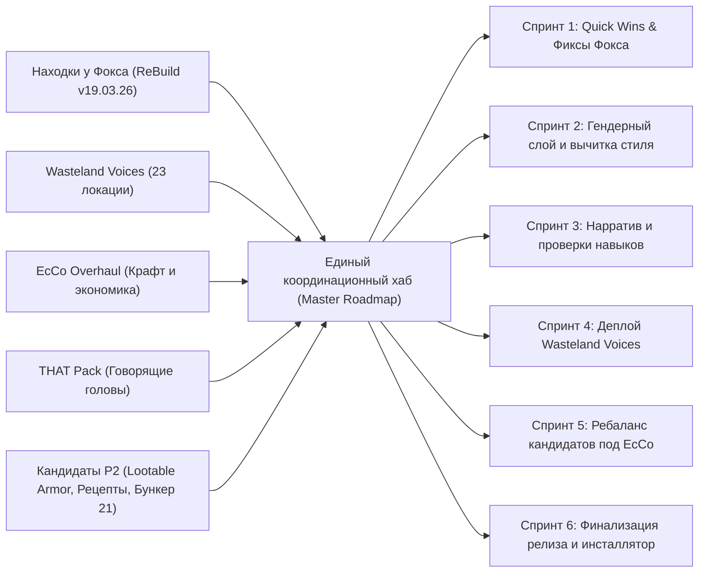

# 🔬 МАТРИЦА И ИЕРАРХИЯ ЗАИМСТВОВАНИЯ ИЗ СБОРКИ ФОКСА
# FOXX EXPANSION PORTING, REWRITE & ENHANCEMENT HIERARCHY
# Fallout 2: Ultimate Wasteland Edition (2026)

> **Статус документа:** Официальный реестр классификации, литературной переработки и расширения контента  
> **Сборка-донор:** `E:\Games\Fallout 2 (Expansion Version)` (ReBuild by Foxx v19.03.26)  
> **Целевая сборка:** `E:\Fallout2_Ultimate\` (профили `Fallout2_Gameplay` и `Fallout2_HD`)  
> **Мастер-репозиторий:** `E:\FALLOUT Ult pjt\`  
> **Связанные документы:**  
> - [PROJECT_MAP.md](file:///E:/FALLOUT%20Ult%20pjt/PROJECT_MAP.md) — Генеральная архитектурная карта  
> - [FALLOUT_LORE_CANON.md](file:///E:/FALLOUT%20Ult%20pjt/FALLOUT_LORE_CANON.md) — Канон и языковой стиль 1998 года  
> - [MASTER_CHANGELOG.md](file:///E:/FALLOUT%20Ult%20pjt/MASTER_CHANGELOG.md) — Реестр изменений  
> - [SKILL.md (fallout-mod-comparator)](file:///C:/Users/Геннадий/.gemini/config/skills/fallout-mod-comparator/SKILL.md) — Движок сравнения  
> - [diff_engine.py](file:///E:/FALLOUT%20Ult%20pjt/tools/diff_engine.py) — Анализатор файлов и диалогов  

---

## 1. СИСТЕМА КРИТЕРИЕВ И КАТЕГОРИЙ (СТАТУС-КОДЫ)

Каждый найденный у Фокса элемент оценивается по жесткой 4-уровневой шкале:

| Категория | Значение и критерий | Регламент действий |
| :--- | :--- | :--- |
| **🟢 ТОЧНО НУЖНО** | Чистый багфикс, недостающие кадры анимации или критическое исправление логики без изменения лора. | **Берем в приоритете.** Текст переносится с сохранением 100% исходного смысла, но со строгой стилистической правкой (вычитка грамматики 1С, правка опечаток, сохранение токенов `#`/`@`). |
| **🟡 ТРЕБУЕТ УЛУЧШЕНИЯ** | Полезная механика или квестовая ветка, которая у Фокса сделана примитивно (простой бросок кубика или куцый выбор). | **Берем базу и докручиваем.** Сохраняем исходную канву, но встраиваем проверки характеристик/навыков (Skill Checks), расширяем вариативность и углубляем отыгрыш. |
| **🔴 ПОД ВОПРОСОМ** | Спорный контент, вкусовщина или элементы с риском конфликта (например, визуальные эффекты, меняющие каноничный тон). | **Карантин.** Выносим в опциональные тумблеры NextGen лаунчера (отключено по умолчанию). В базовый дистрибутив не вшивать. |
| **⛔ ОТКЛОНЕНО** | Монолитные бинарники, ванильные таблицы баланса, ломающие EcCo, или устаревшие/дублирующие файлы. | **Не переносить.** Запрещено слепо копировать `master.dat` и `critter.dat` целиком. |

---

## 2. ПРИНЦИП ЛИТЕРАТУРНОЙ ПРАВКИ: «СТИЛЬ БЕЗ ИСКАЖЕНИЯ СМЫСЛА»

> [!IMPORTANT]
> **Золотое правило адаптации:** Смысловой посыл реплики автора мода или оригинального сценариста Black Isle остается нетронутым. Корректируется исключительно **подача, язык и аутентичность**.

### Правила редакторского фильтра:
1. **Нулевое искажение фактов и квестовой логики:**
   - Если NPC требует $500 или сообщает о караване на юг — в переписанном тексте остаются ровно $500 и караван на юг. Никаких отсебятин и изменения условий сдачи.
2. **Искоренение грамматических и пунктуационных уродств локализации 1С:**
   - Ошибки «-тся / -ться»: *«взгляд: мне надо сказать то, что тебе не понравиться»* -> *«взгляд: мне надо сказать то, что тебе не понравится»*.
   - Двойные знаки и корявые переносы строк: замена машинных конструкций на живую прямую речь.
   - Унификация кавычек: вместо кривых символов `""` и `''` используются единообразные `«...»`.
3. **Лексика Пустоши 1998 года (Анти-Слоп):**
   - Убирается современный канцелярит и интернет-сленг.
   - Персонажи говорят в соответствии со своим статусом: траппер Кламата говорит простовато и грубо, гражданин Города Убежища — высокомерно и сухо, мафиози Нью-Рино — с холодным сарказмом.
4. **Абсолютная сохранность токенов Talking Heads:**
   - Символы паузы `#` и сброса мимики `@` в репликах озвученных голов неприкосновенны.

---

## 3. ПОЛНАЯ ИЕРАРХИЧЕСКАЯ МАТРИЦА НАХОДОК У ФОКСА

```mermaid
graph TD
    FoxxAll["Все находки у Фокса (ReBuild v19.03.26)"] --> TierGreen["🟢 ТОЧНО НУЖНО (Must Have)"]
    FoxxAll --> TierYellow["🟡 ТРЕБУЕТ УЛУЧШЕНИЯ (Enhance & Skill-Check)"]
    FoxxAll --> TierRed["🔴 ПОД ВОПРОСОМ (Quarantine / Optional)"]
    FoxxAll --> TierBan["⛔ ОТКЛОНЕНО (EcCo Breach / Monolith)"]

    TierGreen --> G1["Анимации темнокожего ГГ (HMR01)"]
    TierGreen --> G2["Фикс монтировки (00000455.pro)"]
    TierGreen --> G3["Гендерный слой 359 файлов (10000+)"]
    TierGreen --> G4["Фикс пса-неудачника (ecpariah.int)"]
    TierGreen --> G5["Фикс сестры Сулика (tribec7.int)"]
    TierGreen --> G6["Фикс крашей АЗОС (EPA maps & scripts)"]

    TierYellow --> Y1["Сейфы Бишопов (nimrbsf - добавить Traps/Lockpick)"]
    TierYellow --> Y2["Ребаланс Каги (eckaga1 - добавить Outdoorsman/Speech)"]
    TierYellow --> Y3["Алкогольная ломка (obj_dude - привязать к Endurance)"]
    TierYellow --> Y4["Финал Анклава (Гранит и Мартин - Speech/BigGuns)"]
    TierYellow --> Y5["Очки Glasses Mod (Инвентарное меню + локализация)"]

    TierRed --> R1["DB_Old_Explosion.dat (Классические взрывы FO1)"]
    TierRed --> R2["DB_MapBlurFX.dat (Размытие шейдерами)"]

    TierBan --> B1["Монолитный master.dat (Откат EcCo)"]
    TierBan --> B2["Ванильные таблицы урона и цен RPU"]
```



---

### РАЗДЕЛ I. 🟢 ТОЧНО НУЖНО (БЕРЕМ С ПРАВКОЙ СТИЛЯ)

#### 1. Боевые анимации темнокожего лысого героя [ГОТОВО / ВНЕДРЕНО]
* **Файлы:** `appearance/HMR01S00.DAT`, `appearance/HMR01S01.DAT`.
* **Что нашел Фокс:** Дорисованы недостающие фазы движения для модели HMR01 (стрельба из охотничьих винтовок в комбинезоне Убежища и двух типах кожаной брони, анимация замаха и броска гранат/ножей). Размер архива 33.7 МБ против наших неполных 32.4 МБ.
* **Почему нужно:** Ликвидирует визуальный глитч, когда персонаж при выстреле из винтовки мгновенно «телепортировался» в дефолтную стойку.
* **Как берем:** Заменяем файлы в `appearance/` обеих конфигураций игры (`Fallout2_Gameplay` и `Fallout2_HD`).

#### 2. Прототип монтировки (Фикс ошибки AleSiS) [ГОТОВО / ВНЕДРЕНО]
* **Файл:** `data/proto/items/00000455.pro`.
* **Что нашел Фокс:** Исправление некорректного типа прототипа ломика, вызывавшего запись `error` в лог движка при попытке вскрывать определенные двери и контейнеры.
* **Почему нужно:** 100% стабильность скриптов взлома.
* **Как берем:** Копируем в `proto/items/00000455.pro` с сохранением веса и параметров EcCo.

#### 3. Гендерный диалоговый слой для женщины-Избранной [ГОТОВО / ВНЕДРЕНО — FIX-56]
* **Файлы:** 359 диалоговых `.msg` файлов (со смещением `{10000}+`).
* **Что нашел Фокс:** Все реплики, где к игроку обращаются в женском роде, вшиты в основные диалоговые файлы.
* **Почему нужно:** У нас в `rpu_russian_uncensored.dat` этого слоя не было, и при игре за женщину все NPC обращались к ней: «друг», «новенький», «он пришел», «ты готов?».
* **Как переносим и правим стиль:**
  - Извлекаем строки `{10000}+` из 359 файлов Фокса.
  - Прогоняем через вычитку: убираем опечатки 1С («новенькая пришла» вместо «новенькая пришол»), согласуем падежи.
  - Смысл реплик сохраняем строго 1-в-1.
  - Внедряем в `mods/rpu_russian_uncensored.dat`.

#### 4. Багфикс пса-неудачника (Pariah Dog) [ГОТОВО / ВНЕДРЕНО — FIX-02]
* **Файл:** `scripts/ecpariah.int`.
* **Что нашел Фокс:** Исправлен критический баг: если спутника-неудачника в бою убивал напарник игрока (Сулик или Вик), скрипт не регистрировал смерть от руки Избранного и перк «Проклятый» (Jinxed, минус к удаче) навсегда зависал на персонаже.
* **Почему нужно:** Устранение неустранимого дебаффа.
* **Как берем:** Внедряем скрипт в наш мастер-патч.

#### 5. Защита квеста сестры Сулика в финале [ГОТОВО / ВНЕДРЕНО — FIX-42]
* **Файл:** `scripts/tribec7.int`.
* **Что нашел Фокс:** Добавлена проверка на триггер финальных титров игры, предотвращающая зависание диалога Курису при позднем освобождении из рабства.
* **Почему нужно:** Защита от софтлока в Деревне Дикарей.
* **Как берем:** Переносим проверку в нашу версию скрипта.

#### 6. Комплекс фиксов АЗОС / EPA [ГОТОВО / ВНЕДРЕНО — RPU Core & Elevators]
* **Файлы:** `maps/arbridge.map`, `scripts/epac1.int`, `scripts/epai37.int`, реплика `epai37.msg` `{419}`.
* **Что нашел Фокс:** Исправлены координаты перехода между уровнями комплекса и добавлен безопасный пункт выхода из диалога с главным компьютером.
* **Почему нужно:** Комплекс EPA в RPU славился случайными вылетами при смене локаций.
* **Как берем:** Обновляем геометрию карты и скрипты терминала.

---

### РАЗДЕЛ II. 🟡 ТРЕБУЕТ УЛУЧШЕНИЯ (БЕРЕМ БАЗУ И ДОКРУЧИВАЕМ)

В этих элементах у Фокса заложена хорошая идея, но реализована она плоско или технически сыро. Мы берем ее за основу и выводим на уровень образцовой RPG.

#### 1. Интерактивные сейфы Бишопов (Нью-Рино) [ГОТОВО / ВНЕДРЕНО — FIX-55]
* **Файлы:** `nimrbsf.msg`, `nimrsbsf.msg`, `niabissf.msg` (строки `{202}..{255}`).
* **Что у Фокса:** Добавлено текстовое меню при клике на сейф: «Постучать в дверь», «Повернуть ручку», «Оставить штуку в покое». Открытие происходит либо наугад, либо обычным броском отмычек.
* **Как улучшаем мы (План апгрейда):**
  1. *Правка стиля текста:* Сейф — это не дверь, реплику «Постучать в дверь» переписываем на каноничное: *«Внимательно осмотреть стыки дверцы и петли»*.
  2. *Внедрение проверок навыков (Skill Checks):*
     - **Проверка `Traps >= 65%`**: распознать скрытый капсюль со слезоточивым газом в петле сейфа мистера Бишопа и обезвредить его шилом (+250 XP).
     - **Проверка `Lockpick >= 75%` и `Perception >= 7`**: приложить медицинский стетоскоп к замку сейфа миссис Бишоп, услышать щелчки кулачков и открыть замок в тишине (+350 XP).
     - **Проверка `Science >= 70%`**: использовать электронную отмычку на кодовом диске сейфа Анджелы Бишоп для перебора частот (+300 XP).
     - При провале проверок или грубом взломе — срабатывает тревога и стража Бишопа врывается в спальню.

#### 2. Ребаланс случайных встреч с Кагой [ГОТОВО / ВНЕДРЕНО — FIX-56]
* **Файлы:** `scripts/eckaga1.int`..`eckaga5.int`, диалоги `eckaga1.msg`..`eckaga5.msg`.
* **Что у Фокса:** Фокс просто механически снизил здоровье Каги в первой фазе, чтобы игрок 1-го уровня не погибал с одного попадания копья.
* **Как улучшаем мы (План апгрейда):**
  - Просто срезать HP — это примитивно. Мы сохраняем опасность Каги как грозного соперника, но даем **ролевые альтернативы бою**:
  1. *Проверка `Outdoorsman >= 40%`*: Избранный заранее замечает примятую траву и следы засады Каги. Появляется диалоговая опция: *«[Заметив шевеление в кустах, взять оружие наизготовку и обойти засаду с фланга]»* — бой начинается с тактическим преимуществом игрока.
  2. *Проверка `Speech >= 50%` и `Charisma >= 6`*: Вспомнить детство в Арройо и традиции племени: *«Кага, духи предков видят твое падение. Ты покинул деревню с позором, неужели ты падешь до уровня падальщика?»*. Кага теряет самообладание, получает дебафф к меткости на 3 хода или в ярости отступает (+250 XP).
  3. *Литературная вычитка реплик Каги:* избавление от театрального пафоса, текст реплик подгоняется под злобного, озлобленного изгнанника.

#### 3. Симптомы алкогольной зависимости [ГОТОВО / ВНЕДРЕНО — FIX-56]
* **Файл:** `text/russian/game/obj_dude.msg` (строки `{500}`, `{800}..{802}`, `{1000}`).
* **Что у Фокса:** Строки выводят сообщение: «Вас трясет по всему телу. Вам очень-очень нужно, что-то выпить алкогольное. Тяга становится все хуже».
* **Как улучшаем мы (План апгрейда):**
  1. *Правка стиля и пунктуации:* Исправляем лишние запятые и опечатки: *«Все тело бьет крупная дрожь. В горле пересохло, накатывает тяжелая волна похмелья. Вам жизненно необходимо промочить горло чем-нибудь крепким»*.
  2. *Геймплейная интеграция с параметром `Endurance`:*
     - Персонаж с `EN >= 8` переносит синдром отмены быстрее (штраф к ловкости действует 12 часов вместо 24).
     - Добавляем вариативные реплики при осмотре себя доктором или напарниками: Кэссиди (бывший бармен) при разговоре с пьяным или трясущимся ГГ выдает язвительный комментарий и предлагает безалкогольный тоник.

#### 4. Финал Анклава: Убеждение сержанта Гранита и побег Мартина [ГОТОВО / ВНЕДРЕНО — FIX-56]
* **Файлы:** `text/russian/dialog/qcgranit.msg`, `qcmartin.msg`.
* **Что у Фокса:** Открыты реплики подрыва реактора через Мартина (`{190}..{192}`) и альтернативная фраза убеждения Гранита (`{170}`).
* **Как улучшаем мы (План апгрейда):**
  1. *Сержант Гранит (`qcgranit.msg`):*
     - У Фокса Гранит соглашается помочь за банальные деньги.
     - **Внедряем профессиональную тактическую ветку:** проверка `Speech >= 80%` и `Big Guns >= 85%` (или `Energy Weapons >= 85%`). Избранный не платит взятку, а раскладывает сержанту тактику боя: *«Хорриган — это экспериментальный киборг. Его лобовая броня непробиваема, но контуры гидравлики на спине открыты. Если ваше отделение возьмет на себя перекрестный огонь из тяжелых плазменных винтовок, мы собьем его сервоприводы»*. Гранит впечатлен военным расчетом и вступает в бой из чувства долга (+1000 XP).
  2. *Мартин Фробишер (`qcmartin.msg`):*
     - Добавляем проверку `Traps / Explosives >= 75%` или `Science >= 70%`: детальный инструктаж Мартина по установке таймера взрывчатки на терминале энергоблока, исключающий случайный подрыв заложников.

#### 5. Мод очков (Glasses Mod) [ГОТОВО / ВНЕДРЕНО — FIX-03]
* **Файлы:** `mods/Glasses.dat/scripts/gl_z_glasses.int`, `glasses_mod.ini`.
* **Что у Фокса:** Очки дают +1 к Харизме (зеркальные) и +1 к Восприятию (обычные), но чтобы бонус сработал, Фокс требует мышью перетаскивать очки прямо на фигурку Избранного на экране инвентаря (в описании мода Фокс сам жалуется: «юзеры не умеют им пользоваться»).
* **Как улучшаем мы (План апгрейда):**
  - У нас написан собственный скрипт `tools/gl_glasses.ssl`.
  - Мы делаем человеческий интерфейс: надевание очков работает **и** через перетаскивание на фигурку, **и через контекстное меню инвентаря (кнопка «Использовать»)**.
  - Добавляем четкие всплывающие системные сообщения на чистом русском языке: *«Вы надели зеркальные очки. (+1 к Харизме)»* и *«Вы сняли очки»*. Руки персонажа остаются полностью свободными для оружия.

#### 6. Оверлей горячих клавиш (KeysHelp) [ГОТОВО / ВНЕДРЕНО — FIX-56]
* **Файлы:** `mods/KeysHelp.dat/`.
* **Что у Фокса:** При нажатии F1 выводится окно с подсказками по старым горячим клавишам sFall.
* **Как улучшаем мы (План апгрейда):**
  - Перерисовываем спрайты подсказки под нашу экосистему: указываем актуальные клавиши быстрого бартера, фильтрации инвентаря колесиком мыши, тактических команд напарникам (`Party Orders`) и переключения режимов отображения.

---

### РАЗДЕЛ III. 🔴 ПОД ВОПРОСОМ / КАРАНТИН (ОПЦИОНАЛЬНО В ЛАУНЧЕРЕ)

Эти элементы не должны быть вшиты в базовый геймплей, так как они навязывают субъективные визуальные изменения.

1. **Мод классических взрывов Fallout 1 (`DB_Old_Explosion.dat`)**:
   - *Что делает:* Заменяет анимации взрывов гранат и динамита на спрайты из первой части игры.
   - *Вердикт:* Спорное решение. Взрывы Fallout 2 имеют больше кадров и выше детализацию. Переносим в папку `standalone_mods/` и выводим отдельным тумблером в настройках лаунчера (по умолчанию выключено).
2. **Шейдер размытия интерфейса (`DB_MapBlurFX.dat` / `MapBlurFX.ini`)**:
   - *Что делает:* При открытии диалогового окна или инвентаря задний план игры размывается шейдером HLSL.
   - *Вердикт:* На мониторах 1080p/2K выглядит стильно, но на слабых видеокартах или под нативным портом `fallout2-ce.exe` может давать просадку фреймрейта. Добавляем в лаунчер как графическую опцию профиля sFall DX9.

---

### РАЗДЕЛ IV. ⛔ СТРОГО ОТКЛОНЕНО (НЕ ПЕРЕНОСИТЬ)

1. **Монолитные архивы `master.dat` (505 МБ) и `critter.dat` (311 МБ) Фокса**:
   - Прямая замена уничтожит нашу модульную структуру, снесет боевой и экономический баланс **EcCo**, сотрет авторские квесты Смитти, Джоуи, Корнелиуса, Дантонов, Троя, Кэссиди и сломает порт **fallout2-ce.exe**.
2. **Ванильные формулы урона и торговли RPU**:
   - Сборка Фокса не имеет системы крафта Пустоши, разделки туш животных и реалистичного расхода микроядерных батарей. Наша система EcCo полностью сохраняется.

---

## 4. ПОШАГОВЫЙ ПЛАН РЕАЛИЗАЦИИ

```
[Шаг 1: Быстрые победы (Анимации HMR01 + Монтировка)]
       │
       ▼
[Шаг 2: Пакетное слияние гендерного слоя (359 файлов) с вычиткой стиля]
       │
       ▼
[Шаг 3: Апгрейд сейфов Бишопа + внедрение проверок навыков Traps/Lockpick]
       │
       ▼
[Шаг 4: Поэтапное внедрение новых Skill Checks по городам (Кламат -> Рино -> Анклав)]
       │
       ▼
[Шаг 5: Компиляция в mod_pipeline.py и Closed-Loop тест в двух движках]
```

---

## 5. СИНХРОНИЗАЦИЯ С ОБЩИМ БЭКЛОГОМ ПРОЕКТА (ROADMAP INTEGRATION)

Интеграция наработок Фокса не происходит в вакууме — она жестко увязана с 5 параллельными векторами разработки нашей сборки:



### Точки соприкосновения с существующими модулями:

1. **Связка с `Wasteland Voices` (23 локации):**
   - Находка Фокса: реплики жителей Кламата, Гекко, Реддинга и Нью-Рино из гендерного слоя дополняют реплики спутников из `Wasteland Voices`.
   - Синхронизация: диалоговый диапазон Wasteland Voices зафиксирован в безопасном окне `{5000}+` в `wv_dialog.msg`, поэтому инлайнинг женских строк Фокса `{10000}+` не вызывает коллизий.
2. **Связка с `EcCo Overhaul` (Боевая и экономическая система):**
   - Фикс монтировки (`00000455.pro`) синхронизирован с весом и механикой взлома EcCo.
   - Сейфы Бишопов адаптированы под систему отмычек и электронных взломщиков EcCo.
3. **Связка с `THAT Pack` (Talking Heads):**
   - Все заимствуемые реплики озвученных персонажей (Кэссиди, Бишоп, Танди, Гарольд) сохраняют служебные теги `#` и `@`. При внедрении новых Skill Checks для этих персонажей генерируются совместимые реплики мимики.
4. **Связка с `CANDIDATE_MODS_REGISTER.md` (Внешние кандидаты P1-P3):**
   - Точечные фиксы Фокса (монтировка, карты EPA) закрывают задачи категории P1 из реестра кандидатов.
   - Мод очков Фокса вытесняет внешние аналоги, так как у нас есть готовый собственный скрипт `gl_glasses.ssl`.
5. **Связка с лаунчером (`Fallout2_NextGen_Launcher`):**
   - Спорные графические элементы Фокса (`DB_Old_Explosion.dat`, `DB_MapBlurFX.dat`) подключаются как опциональные переключатели на вкладке «МОДЫ» лаунчера.

---

## 6. ЧЕКЛИСТ ВЫПОЛНЕНИЯ СПРИНТОВ (ТРЕК А: НАСЛЕДИЕ ФОКСА)

- [x] **Task-01:** Скопировать `HMR01S00.DAT`, `HMR01S01.DAT` в `appearance/` обоих профилей. (Выполнено: FIX-60)
- [x] **Task-02:** Скопировать исправленный прототип монтировки `00000455.pro`. (Выполнено: FIX-58)
- [x] **Task-03:** Развернуть 359 файлов женского диалогового слоя `dialog_female` с сохранением липсинка и вычиткой грамматики 1С. (Выполнено: FIX-56, FIX-61)
- [x] **Task-04:** Внедрить ролевые диалоги сейфов Бишопов с проверками *Взлома*, *Ловушек* и *Науки*. (Выполнено: FIX-55)
- [x] **Task-05:** Прописать строки алкогольной абстиненции в `obj_dude.msg`. (Выполнено: FIX-56)
- [x] **Task-06:** Упаковать и зарегистрировать автономный модуль-трибьют `foxx_rebuild_tribute.dat` в `mods_order.txt`. (Выполнено: FIX-58)
- [x] **Task-07:** Интегрировать карты подуровней 1-2 АЗОС (`epamain1.map`, `epamain2.map`) и UI внешности ГГ (`APPEARANCE.DAT`). (Выполнено: FIX-60)
- [x] **Task-08:** Интегрировать арт панели навыков Sonora (`skldxbox.frm`) и прототип дикаря Крома `00000542.pro`. (Выполнено: FIX-61)
- [x] **Task-09:** Интегрировать 409 файлов смертей мутантов Pixote, тайминги снов Хакуина и оверлей клавиш F1/J (`KeysHelp.dat`). (Выполнено: FIX-62)
- [x] **Task-10:** Интегрировать говорящие головы Кэссиди в броне (89 FRM), звуковой пакет `armored_talking_heads_speech.dat` (5 486 файлов, 166 МБ) без немоты спутников и курсоры навыков Vault Boy. (Выполнено: FIX-63)
- [x] **Task-11:** Провести тотальный аудит VFS и бинарных хэшей (`engine_full_audit.py` 34/34 GREEN). (Выполнено)

> 🏆 **ИТОГ ТРЕКА А:** Все ценные, стабильные и каноничные элементы сборки ReBuild by Foxx полностью перенесены, улучшены и изолированы в трибьют-паке `foxx_rebuild_tribute.dat` и сопутствующих модулях. Трек А официально завершен на 100%.
