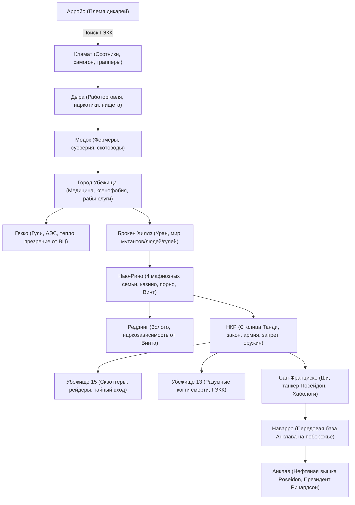

# ☢️ КАНОН И ОПЕРАЦИОННЫЙ КОДЕКС ЛОРА // FALLOUT 2 LORE CANON & INVARIANTS
# ТАЙМЛАЙН: 2241 ГОД // РЕГИОН: СЕВЕРНАЯ КАЛИФОРНИЯ (NEW CALIFORNIA)

> 🧭 **ГЕНЕРАЛЬНАЯ НАВИГАЦИЯ ПО ПРОЕКТУ FALLOUT 2 ULTIMATE:**  
> [🗺️ PROJECT_MAP.md](file:///E:/FALLOUT%20Ult%20pjt/PROJECT_MAP.md) — Генеральная карта проекта, архитектура и статус модулей  
> [📋 PATCHES_REGISTRY.md](file:///E:/FALLOUT%20Ult%20pjt/PATCHES_REGISTRY.md) — Реестр всех выполненных фиксов (FIX-01..FIX-67)  
> [📜 MASTER_CHANGELOG.md](file:///E:/FALLOUT%20Ult%20pjt/MASTER_CHANGELOG.md) — Подробный ченджлог нововведений и исправлений  
> [📘 Fallout.md](file:///E:/FALLOUT%20Ult%20pjt/Fallout.md) — Мастер-план, дорожная карта и журнал синхронизации чатов (Live Sync Log)  
> [⚖️ FALLOUT_LORE_CANON.md](file:///E:/FALLOUT%20Ult%20pjt/FALLOUT_LORE_CANON.md) — Кодекс лора и канона 2241 года (Black Isle / Avellone)  
> [🔬 FOXX_MATRIX.md](file:///E:/FALLOUT%20Ult%20pjt/Docs/FOXX_PORTING_AND_EXPANSION_MATRIX.md) — Матрица интеграции наследия Foxx ReBuild  

> 🛡️ **ЗОЛОТОЙ РЕГЛАМЕНТ ДЛЯ ЛЮБОГО АГЕНТА И ЧАТА (ПРОВЕРКА ПЕРЕД РАБОТОЙ):**  
> 1. **ПРОВЕРКА ВЫПОЛНЕННЫХ РАБОТ:** Перед тем как предлагать пользователю задачу или писать код, ОТКРОЙ [PATCHES_REGISTRY.md](file:///E:/FALLOUT%20Ult%20pjt/PATCHES_REGISTRY.md). Если задача уже есть в списке (FIX-01..FIX-67), ОНА УЖЕ ВНЕДРЕНА И ПРОТЕСТИРОВАНА. Категорически запрещено предлагать её повторно!  
> 2. **ПРОВЕРКА АКТИВНОГО ФРОНТА:** Сверься с разделом «Активный фронт разработки» в [PROJECT_MAP.md](file:///E:/FALLOUT%20Ult%20pjt/PROJECT_MAP.md) и [Fallout.md](file:///E:/FALLOUT%20Ult%20pjt/Fallout.md). Бери в работу ТОЛЬКО те задачи, которые имеют статус [В ОЧЕРЕДИ] или [В РАЗРАБОТКЕ].  
> 3. **ФИКСАЦИЯ ИТОГОВ РАБОТЫ (CLOSED-LOOP):** Добавить строку FIX-XX в [PATCHES_REGISTRY.md](file:///E:/FALLOUT%20Ult%20pjt/PATCHES_REGISTRY.md), подробное описание в [MASTER_CHANGELOG.md](file:///E:/FALLOUT%20Ult%20pjt/MASTER_CHANGELOG.md), закрыть чекбокс [ГОТОВО] в [Fallout.md](file:///E:/FALLOUT%20Ult%20pjt/Fallout.md) и подтвердить тестом py tools/engine_full_audit.py (34/34 GREEN).

> **Статус документа:** Генеральный кодекс лора и канонический фильтр проекта  
> **Хронологический фокус:** 2241 год (События Fallout 2)  
> **Первоисточники канона:** Fallout 1 (1997), Fallout 2 (1998), Fallout Bible (Chris Avellone, 2002), Fallout: New Vegas (Obsidian, 2010), дизайн-документы Tim Cain & Leonard Boyarsky  
> **Запрет на ретконы:** Полный запрет на перенос ретконов Bethesda (Fallout 3, 4, 76 и сериала) в диалоги и скрипты Fallout 2  

---

## 1. АДВОКАТ ДЬЯВОЛА (RED TEAM): ГДЕ СПОТЫКАЮТСЯ МОДДЕРЫ И НЕЙРОСЕТИ

При создании квестов, диалогов и модов для Fallout 2 авторы совершают 5 типовых фатальных ошибок:

1. **«Синдром единого лора Bethesda» (The Retcon Leak):**
   * *Ошибка:* Использование фактов из Fallout 4/76 (например, «Винт был до войны в убежищах», «силовая броня жрет ядерные блоки за 15 минут», «стрельба ржавыми трубчатыми пушками везде»).
   * *Канонический факт 2241 года:* В классическом каноне Западного Побережья Винт (Jet) синтезирован вундеркиндом Майроном в Нью-Рино около 2240 года на парах браминьего навоза. Силовая броня T-51b и APA Mk I имеет встроенный микроядерный реактор TX-28, рассчитанный на 100–200 лет непрерывной работы без смены батарей.
2. **Нарушение биологии ВРЭ (FEV) и супермутантов:**
   * *Ошибка:* Попытки показать детей-мутантов, размножение супермутантов или выдумывание «женщин-мутанток с грудью».
   * *Канонический факт:* Все супермутанты Создателя (Поколение 1) и мутанты Анклава из Марипозы (Поколение 2) **генетически стерильны**. Вирус Рукотворного Эволюционирования (FEV-II) рассматривает гаметы как поврежденные клетки с одинарным набором хромосом и «исправляет» их, полностью уничтожая репродуктивную функцию. Осознание этой стерильности сломало Создателя в 2161 году.
3. **Искажение гулей и радиации:**
   * *Ошибка:* Превращение гулей в классических зомби или объяснение их появления через вирус ВРЭ.
   * *Канонический факт:* Гулификация — это результат колоссального нелетального облучения радиацией людей с определенной генетической мутацией устойчивости клеток. Гули разумны, не теряют человечности (кроме одичавших от разрушения коры головного мозга в Городе Мертвых), живут сотни лет, но их ткани медленно некротизируют.
4. **Анахронизм фракций (Преждевременная гибель или гипертрофия):**
   * *Ошибка:* Изображение Братства Стали как огромной правящей армии или изображение НКР как слабой деревушки.
   * *Канонический факт 2241 года:* НКР (Новая Калифорнийская Республика) под руководством стареющей Танди — это мощнейшее демократическое государство с армией, полицией, судами и 5 штатами. Братство Стали, напротив, в 2241 году уже в упадке, замкнулось в бункерах и лишь скрытно наблюдает за полетами винтокрылов Анклава через мини-посты в Сан-Франциско, Дыре и НКР.
5. **Потеря тональности и языка 1998 года:**
   * *Ошибка:* Слащавый пафос, героическое фэнтези, современный зумерский сленг или унылый канцелярит.
   * *Канонический факт:* Fallout 2 говорит на стыке **жесткого циничного нуара, ретрофутуризма 50-х годов и едкого черного юмора**. Здесь торгуют людьми, продают наркотики, травят крыс, шутят про радиацию, но в сердце драмы всегда остается человеческая цена выживания.

---

## 2. ГЕОГРАФИЯ И СОЦИАЛЬНАЯ КАРТА 2241 ГОДА

---

## 3. ПОЛНЫЙ ПАСПОРТ ФРАКЦИЙ И РЕГИОНОВ (2241 ГОД)

### 3.1. Племя Арройо (Arroyo)
* **Культура:** Дикари-охотники, потомки Выходца из Убежища 13. За 80 лет скатились в полуплеменной строй, поклоняются священному комбинезону «13» и фляге.
* **Кризис:** Жесточайшая засуха, гибель посевов, падеж двухголового скота.
* **Ключевые фигуры:** Старейшина (дочь Выходца), Хакунин (шаман, связь через сны), Торр (пастух-дитя Пустоши).
* **Цель Избранного:** Найти священный ГЭКК (GECK / Косогор — Генератор Эдемских Кущ Компактный) в Убежище 13.

### 3.2. Город Убежища (Vault City / Убежище 8)
* **Культура:** Технократический апартеид, стерильная ксенофобия. Жители делятся на «Граждан» (чистокровные жители убежища) и «Слуг» (закабаленные жители Пустошей).
* **Технологии:** Передовая медицина, автодоки, импланты, клонирование органов, силовые поля.
* **Конфликты:** 
  - Ненависть к гулям Гекко из-за загрязнения грунтовых вод реактором АЭС №5.
  - Нападения наемников-рейдеров, тайно спонсируемых семьей Бишоп из Нью-Рино.
* **Лидеры:** Первая Гражданка Линнетт (жесткая диктаторша), Старший Сенатор МакКлюр (прагматичный политик), Доктор Трой (главврач).

### 3.3. Нью-Рино (New Reno)
* **Культура:** Город греха, казино, публичных домов, наркокартелей и подпольного кино. Управляется 4 криминальными семьями:
  1. **Семья Сальваторе:** Контрабанда лазерного оружия через тайные сделки с Анклавом. Лидер — Луис Сальваторе (на кислородном аппарате).
  2. **Семья Бишоп:** Экспансионисты, хотят ввести Нью-Рино в состав НКР на правах олигархов, нанимают рейдеров против Города Убежища. Лидер — Джон Бишоп.
  3. **Семья Мордино:** Создатели и монополисты Винта (Jet), спонсируют лаборатории Майрона, пытаются подсадить на Винт шахтеров Реддинга, чтобы скупить золотые рудники. Лидер — Большой Хесус Мордино.
  4. **Семья Райт:** Торговцы алкоголем, придерживаются семейных традиций, не переносят наркотики. Лидер — Орвилл Райт.

### 3.4. Новая Калифорнийская Республика (НКР / Шейди Сэндс)
* **Культура:** Законное конституционное государство. 5 штатов, президентская республика. На улицах столицы категорически запрещено открытое ношение оружия.
* **Идеология:** Демократия, централизация, налоги, искоренение работорговли, экспансия на север.
* **Лидеры:** Президент Танди (дочь Арадеша, национальный лидер, правит уже более 40 лет), Карлсон (вице-президент), Шериф Дюмон.
* **Враги:** Рейдеры, работорговцы Дыры, непокорные олигархи Нью-Рино, Анклав.

### 3.5. Анклав (The Enclave)
* **Суть:** Прямые наследники довоенного теневого правительства США, элиты и ВПК.
* **База:** Нефтяная платформа Poseidon Oil в Тихом океане (Control Station Enclave) + континентальный аванпост Наварро (Navarro).
* **Идеология геноцида:** Считают всех жителей материка (людей, гулей, мутантов) «необратимо генетически загрязненными мутантами». План: распылить модифицированный штамм ВРЭ Curling-13 через атмосферу и очистить континент для чистокровного человечества.
* **Вооружение:** Продвинутая силовая броня (Advanced Power Armor Mk I/II), винтокрылы (Vertibird), плазменное и импульсное оружие, генная инженерия.
* **Лидеры:** Президент Дик Ричардсон, Секретный Агент Фрэнк Хорриган (генетически аугментированный супермутант-киборг в силовой броне, личный палач Президента), Доктор Керлинг.

### 3.6. Ши (The Shi / Сан-Франциско)
* **Культура:** Потомки экипажа китайской атомной подводной лодки «Шихуанди» (Shi-huang-ti), севшей на мель в заливе Сан-Франциско в 2077 году.
* **Специфика:** Китайская традиционная эстетика, культ науки, закрытость, боевые искусства.
* **Технологии:** Разработка биогеля, полимерных покрытий для брони, дешифровка довоенных компьютеров, очистка топлива для танкера.
* **Лидер:** Император Ши (как выясняет игрок — самообучающийся суперкомпьютер с нейросетью), Кевин Чен (советник).

### 3.7. Братство Стали (Brotherhood of Steel)
* **Состояние в 2241 году:** Фаза глубокой консервации и заката на Западе. Не вмешиваются в дела городов, наблюдают за технологиями.
* **Представительство:** Аванпосты в виде неприметных офисов с эмблемой шестерни и меча в Дыре, НКР и Сан-Франциско.
* **Посланник:** Мэттью (Сан-Франциско), поручает Избранному проникнуть в Наварро и выкрасть чертежи винтокрылов.

---

## 4. ФИЗИКА, БИОЛОГИЯ И ТЕХНИЧЕСКИЕ ИНВАРИАНТЫ ПУСТОШЕЙ

| Элемент мира | Железный канонический факт | Чего НИКОГДА не может быть |
| :--- | :--- | :--- |
| **Винт (Jet)** | Создан Майроном из испарений метана браминьего дерва около 2240 г. Мгновенно вызывает тяжелейшую химическую и психическую зависимость. | Не существовал до Великой Войны 2077 года. Нельзя встретить в запечатанных довоенных сейфах. |
| **Супермутанты** | Получены погружением людей в чаны с ВРЭ-II на базе Марипоза. Бесплодны. Живут долго, если не поврежден мозг (первое поколение Создателя — умные, второе поколение Анклава — тупые). | Не могут иметь детей половым путем. Не имеют полового диморфизма. |
| **Когти Смерти У13** | Выведены учеными Анклава с помощью генной модификации штаммом ВРЭ для повышения интеллекта. Умеют говорить, читать, философы (Горис, Грутар). | Не являются тупыми дикими ящерицами (в Убежище 13 это разумная колония с моральным кодексом). |
| **Силовая броня** | Довоенные экзоскелеты T-51b (США) и послевоенная APA (Анклав). Питаются от ядерного микрореактора TX-28. Защищают от радиации, пуль, взрывов, дают +3..+4 к Силе. | Не требуют «замены ядерных батареек каждые 15 минут» (механика Bethesda F4/76 запрещена). |
| **Хайвеймен (Highwayman)** | Двухместный ядерный седан Chryslus Motors 2077 года выпуска. Работает на малых батарейках (SEC) и ядерных микрореакторах (MFC). | Не работает на бензине или дизеле. |
| **Валюта в 2241 году** | Золотые монеты, довоенные доллары (мусор), бартерный эквивалент, золотые монеты Реддинга, золотые банкноты НКР. Крышки в 2241 году на Западном Побережье почти вышли из оборота! | Возврат крышек как главной валюты произойдет только позже в Мохаве из-за Воды, в 2241 году в НКР ходят чеканные деньги. |

---

## 5. ЛИНГВИСТИЧЕСКИЙ СТАНДАРТ ДИАЛОГОВ (КАК ГОВОРЯТ В ПУСТОШАХ)

1. **Дикари Арройо:** Архаичный, уважительный строй речи, обращение к предкам, духам земли, Старейшине. Отсутствие современных технических терминов («железные птицы» вместо винтокрылов).
2. **Город Убежища:** Стерильный, высокомерный бюрократический тон. Слова-маркеры: «Гражданин», «Обитатель пустошей», «Слуга», «Нарушение директивы», «Нестерильно».
3. **Нью-Рино:** Агрессивный сленг мафиозных семейств, итало-американские и уличные интонации, мат по делу, цинизм, бандитские клички, угрозы без прелюдий.
4. **Анклав:** Сухой уставной милитаристский тон офицеров армии США. Безапелляционная убежденность в собственном превосходстве и презрение к «грязным мутантам» с материка.

---

### 5.1. ЗОЛОТОЙ СТАНДАРТ ЛОКАЛИЗАЦИИ: ГИБРИД 1С + ФАРГУС (AUTHENTIC UNCENSORED)

В сборке действует нерушимый стандарт перевода, установленный Геннадием Лаптевым:

* **В чем проблема раздельных версий:**
  - **Официальный перевод 1С:** дал техническую полноту и стабильность переменных, но был испорчен ханжеской цензурой. Бандиты, шлюхи и мафиози в нем разговаривают как институтки («шалуны», «негодники», «пострелята»), вырезана взрослая атмосфера 18+.
  - **Классический перевод «Фаргуса»:** подарил игре легендарную дерзость, едкий черный юмор, брань по делу, сочный сленг Пустошей и живые характеры (Кэссиди, Майрон, Мецгер, семьи Рино), но страдал от технических багов и пропущенных строк в квестах.
* **Наш стандарт — Гибрид 1С + Фаргус:**
  1. **Инженерный фундамент:** от 1С берутся проверенные системные строки, точные названия квестовых предметов, переменные и технические описания без обрезки кода.
  2. **Душа и диалоги:** от «Фаргуса» сохраняется дерзкий, хлесткий, нецензурированный язык Пустошей.
  3. **Правило для всех новых модов (включая RP Companion Expansion):**  
     Категорически запрещено делать «стерильный» или сухой академический перевод. Реплики новых напарников (уличная девчонка Сери, наемница Лара, взрослеющая Мирия) обязаны звучать **дерзко, живо и по-фаргусовски**, органично дополняя наш базовый мод `rpu_russian_uncensored.dat`.

---

## 6. ЗАКЛЮЧЕНИЕ ДЛЯ АГЕНТА-РАЗРАБОТЧИКА

При написании любых скриптов, диалогов или квестов:
1. Сверяться с этим документом: персонаж не может знать фактов, которых нет в 2241 году.
2. Не ломать баланс и канон: никаких пришельцев из космоса посреди квестов, современного реального спецназа или шуточных интернет-мемов.
3. Каждая деталь должна ощущаться так, будто её утвердил Крис Авеллон в Black Isle Studios в 1998 году.
