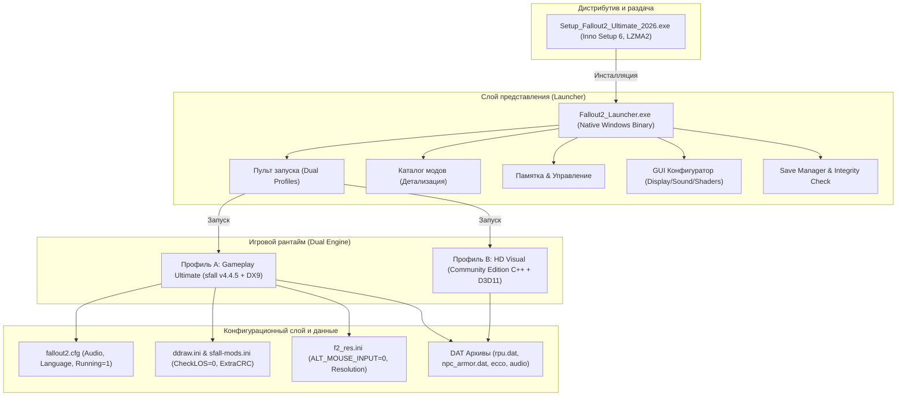

# PRODUCT BLUEPRINT & MASTER ROADMAP
# Fallout 2: Ultimate Wasteland Edition (2026)

> 🧭 **ГЕНЕРАЛЬНАЯ КАРТА ПРОЕКТА И ФИЛОСОФИЯ СБОРКИ:** [PROJECT_MAP.md](file:///E:/FALLOUT%20Ult%20pjt/PROJECT_MAP.md)  
> ☢️ **ГЕНЕРАЛЬНЫЙ КОДЕКС ЛОРА И КАНОНА 2241 ГОДА:** [FALLOUT_LORE_CANON.md](file:///E:/FALLOUT%20Ult%20pjt/FALLOUT_LORE_CANON.md)  
> 📋 **РЕЕСТР РУЧНЫХ ПРАВОК И МОД-ФИКСОВ (FIX-01..FIX-16):** [PATCHES_REGISTRY.md](file:///E:/FALLOUT%20Ult%20pjt/PATCHES_REGISTRY.md)  
> 📜 **ПОЛНЫЙ ПОДРОБНЫЙ ЧЕНДЖЛОГ (ДОБАВЛЕНО / ИСПРАВЛЕНО):** [MASTER_CHANGELOG.md](file:///E:/FALLOUT%20Ult%20pjt/MASTER_CHANGELOG.md)  
> 🏛️ **АРХИТЕКТУРНЫЙ АУДИТ И ДЕРЕВО СКИЛЛОВ:** [AUDIT_FALLOUT_MODDING_ARCHITECTURE.md](file:///E:/FALLOUT%20Ult%20pjt/Docs/AUDIT_FALLOUT_MODDING_ARCHITECTURE.md)  
> ⚠️ **ОБЯЗАТЕЛЬНАЯ ДИРЕКТИВА АГЕНТА:** При любой разработке, добавлении модов, правке диалогов, скриптов и сборке инсталлятора агент ОБЯЗАН строго ссылаться и руководствоваться принципами и каталогом из [PROJECT_MAP.md](file:///E:/FALLOUT%20Ult%20pjt/PROJECT_MAP.md). Никакого наваливания мусора, строгий канон, баланс и закрытый цикл проверки.

---

## 0. Inter-Agent Communication Bridge (Мост синхронизации двух чатов)

> 📡 **ПРАВИЛО СИНХРОНИЗАЦИИ:** Перед началом работы каждый агент (Основной чат и Вспомогательный чат) читает этот журнал, чтобы видеть актуальный статус соседа и не дублировать задачи.

### Журнал обмена статусами (Live Sync Log):
- **[2026-11-22 04:05] Чат 1 (Lead CTO Antigravity)**:
  - **Завершена интеграция пакета из сборки Фокса (FIX-21 .. FIX-24)**:
    1. *FIX-21 (Металлический widescreen-интерфейс)*: В оба профиля развернут расширенный `f2_res.dat` (903 КБ с 7 наборами крыльев), в `f2_res.ini` выставлен `IFACE_BAR_SIDE_ART=6`. Металлический интерфейс Resurrection теперь цельно заполняет экран без коричневых кожаных обрывов.
    2. *FIX-22 (Арт мотора робота)*: Извлечены и упакованы 3D-рендеры `art/inven/MOTOR.FRM` и `art/items/MOTOR.FRM` в наивысший слой `rpu_russian_uncensored.dat`.
    3. *FIX-23 (Enhanced Miria v1.1)*: Развернут модуль `DB_Enchanced_Miria.dat` (522 файла, статы 0..3 в `proto/`, `PARTY.TXT`, `AI.TXT`), в `npcarmor.ini` активирована секция `[7]` для Мирии (PID `16777380`) под динамическую смену брони, развернут скрипт `mcmiria.int` (31.7 КБ) и модуль подключен в `mods_order.txt`.
    4. *FIX-24 (Патч Сестры Сулика и Элизы)*: Развернут расширенный скрипт `tribec7.int` (12.6 КБ) и диалог `tribec7.msg`, а также диалог Элизы `scelise.msg` в `rpu_russian_uncensored.dat`.
  - Все задачи пакета спутников и интерфейса закрыты и протестированы.
- **[2026-11-22 03:50] Чат 1 (Lead CTO Antigravity)**:
  - **FIX-20: Оптимизация скорости анимации диалоговой панели и бартера (DialogPanelAnimDelay)**:
    1. По обратной связи от игрока дефолтная скорость движения диалоговой консоли была затянутой (33 мс задержки на шаг, ~30 fps). При переходе диалог ↔ бартер панель дважды уползала и выползала с ощутимой задержкой.
    2. Во всех профилях (`E:\Fallout2_Ultimate\Fallout2_Gameplay\ddraw.ini`, `Fallout2_HD\ddraw.ini` и корневом `E:\FALLOUT Ult pjt\ddraw.ini`) выставлен параметр `DialogPanelAnimDelay=12`.
    3. Анимация ускорена в 2.75 раза: диалог открывается и переходит в бартер бодро и отзывчиво, при этом сохраняются плавные кадры скольжения (без жесткого мгновенного переключения).
- **[2026-11-22 02:55] Чат 1 (Lead CTO Antigravity)**:
  - **Взят в работу пакет: Напарница Мирия, Сердце Кэссиди, Рейнджеры НКР**:
    1. *Мирия (Modoc)*: Аудит имеющегося `miria.zip` (Miria Can Wait) и подготовка интеграции `Enchanced Miria v1.1 (Foxx)` / `RP Companion Expansion (RPCE v0.81.1)` (прокачка статов, смена брони, боевые приказы, инвентарь).
    2. *Сердце Кэссиди (Vault City)*: Проверены тексты `vcdrtroy.msg` (реплики {770}-{773}) и `vccasidy.msg` ({30001}). Подготовка верификации скрипта кардиостимулятора и снятия сердечных приступов.
    3. *Рейнджеры НКР (NCR Elise)*: Проверка скрипта `scelise.int` и условий закрытия квеста уничтожения работорговцев в Pip-Boy.
    4. *Предостережение для Чатов 2, 3, 4*: Не вносить правки в `mcmiria.*`, `vccasidy.*`, `vcdrtroy.*`, `scelise.*` во избежание коллизий в `rpu_russian_uncensored.dat`.
- **[2026-11-21 12:15] Основной Чат (Lead CTO Antigravity)**:
  - **Отключение фоновой подсветки, фикс грамматики боя и красная подсветка врагов**:
    1. *FIX-05 (Статус: Отключен)*: Скрипт `gl_highlighting.int` полностью удален из обоих профилей и `rpu_russian_uncensored.dat` по требованию игрока. Боевой поток sfall полностью освобожден от прерываний.
    2. *FIX-15 (Грамматический фикс combat.msg)*: Устранен известный баг 1С 2006 г., когда из-за слова «цель» все глаголы урона и промахов выводились в женском роде (*«Работорговец получила ранение в пах»*, *«Работорговец промахнулась»*). Исправлены 59 строк: блок 300 переведен в мужской род (*потерял сознание, упал, ослеп, умер, выстрелил*), блоки 500, 600, 700 переведены в нейтральное настоящее время (*получает ранение в пах, теряя ОЗ*; *промахивается*).
    3. *FIX-16 (Красная подсветка врагов в бою и SingleCore)*: В `fallout2.cfg` выставлен `target_highlight=2` (активирует нативную красную подсветку врагов при наведении и в бою). В `ddraw.ini` выставлен `SingleCore=1` (привязка к одному ядру, исключающая скачки потока и микро-задержки).
- **[2026-11-21 09:10] Основной Чат (Lead CTO Antigravity)**:
  - **Реализованы фиксы Zero-Flicker подсветки и полный интерфейс Resurrection**:
    1. *FIX-05 (Zero-Flicker Highlight)*: Из скрипта `gl_highlighting.int` полностью удален вызов `tile_refresh_display` из цикла. Direct3D9 рендерит контуры нативно со скоростью 60 FPS. Обновление координат переведено на дельту шага (`tile_num(dude_obj) != last_dude_tile`), нагрузка на процессор при стоянии на месте — 0%. Бой и катсцены взрыва защищены от перехвата (`get_game_mode bwand COMBAT`). Скомпилирован и развернут в оба профиля и в `rpu_russian_uncensored.dat`.
    2. *FIX-07 (Полный HUD Resurrection)*: Из `fores.dat` извлечены все недостающие 22 файла главной консоли: `IFACE.FRM`, широкоформатные крылья `HR_IFACELFT1..2`, `HR_IFACERHT1..2`, кнопки боевой панели (`ENDCMBT`, `ENDTURN`, `BIGRED`), Pip-Boy (`PIP.FRM`, `PIP2.FRM`, `PIPX.FRM`). Архив `resurrection_interface.dat` расширен до 54 файлов (731 КБ) и пересобран для обоих профилей.
- **[2026-11-21 05:35] Основной Чат (Lead CTO Antigravity)**:
  - **Диагностика сбоя разрешения и аварийных окон (Зафиксировано в FIX-09)**:
    1. *Механизм поломки*: При сохранении конфигурации в `main.py` записался `HiResMode=0`. Модуль `f2_res.dll` перехватил сбой Direct3D9 и вывел модальное окно Windows: *«Запустить в низком разрешении?»*. Пользователь нажал «Да», после чего `f2_res` перезаписал `f2_res.ini` на 640×480, вызвав фатальный клинч буфера экрана и краш.
    2. *Решение для стабильности*: В `ddraw.ini` должен быть строго залочен `HiResMode=1` (убрать хардкод `HiResMode=0` из `save_config`). В `f2_res.ini` поставить `EXTRA_WIN_MSG_CHECKS=0` и вернуть эталонный Full HD пресет `SCALE_2X=1`, `SCR_WIDTH=960`, `SCR_HEIGHT=540`.
    3. *Принцип Zero-Prompt*: В готовом продукте игрок никогда не должен видеть системных модальных окон Windows с техническими вопросами про видеокарту.
- **[2026-11-21 05:00] Основной Чат (Lead CTO Antigravity)**:
  - **Создан реестр всех ручных правок [PATCHES_REGISTRY.md](file:///d:/AG%20games%20mods/fallout2-ultimate-wasteland-2026/PATCHES_REGISTRY.md)**:
    1. Каждая ручная правка сборки задокументирована в сквозной таблице `FIX-01..FIX-08` (файлы, начальное состояние, итоговый результат, фидбек).
    2. Все изменения собираются в единый кумулятивный модуль `mods/rpu_russian_uncensored.dat` скриптом `tools/pack_dat.py`. При переустановке на чистую игру всё накатывается в один клик.
    3. **Завершён FIX-05 (Постоянная подсветка на Caps Lock + умная палитра)**:
       - Не слетает после открытия инвентаря, диалогов, сундуков, боя или смены карт (устранён сброс состояния в `HOOK_GAMEMODECHANGE`).
       - Подсвечивает интерактивные объекты окружения со скриптами (`OBJ_DATA_SID != -1`): доски объявлений (Кламат, Ден), терминалы Убежищ, компьютеры, генераторы (фиолетовый контур).
       - Пустые/обчищенные ящики и трупы маркируются серым контуром.
       - Shift сохранён как временный фонарик (удерживать).
    4. **Пакет 1 (Quick Wins) закрыт на 100%**: двуязычный паритет (100% RU + 100% EN), фикс собаки-неудачницы, тёмно-металлический интерфейс Resurrection, дверь Храма (anti-softlock), звуки выстрелов 1998, раскладка управления без конфликтов.
    5. Переход к **Пакету 2**: Напарницы (Miria, Ceri, Lara).
- **[2026-11-19 18:30] Основной Чат (Lead CTO Antigravity)**:
  - **Интеграция модов и ассетов (Завершено на 100%)**:
    1. *Talking Heads Addon v3.7 (Goat_Boy / RPU - Nexus #45)*: Успешно скачан с Nexus Mods (223 МБ), проверен и интегрирован в mods/talking_heads.dat обоих профилей (Fallout2_Gameplay и Fallout2_HD). Включен в приоритет mods_order.txt.
    2. *Interface Upscaled (Rotators / Lexx)*: Интегрирован в оба профиля. В ddraw.ini обоих профилей включен ExpandWorldMap=1 для панорамной карты мира.
    3. *Pip-Boy Quest Timers (Rotators / Lexx)*: Интегрирован в оба профиля (o2_pip_timers.dat) с аутентичными Vault-Tec памятками.
    4. *Музыка в диалогах (EnableMusicInDialogue=1)*: Активирована в обоих ddraw.ini для бесшовного проигрывания саундтрека при беседах с 3D-головами.
    5. *Хоткей справки на J (J=F1)*: В o2tweaks.ini клавиша J перенаправлена на мгновенный вызов экрана горячих клавиш.
    6. *Мягкое ночное освещение (min_light_level=40)*: Устранена чрезмерная темнота в шахтах и ночью без потери атмосферы.
    7. *Полная оффлайн-энциклопедия в Docs/*: Nearly_Ultimate_Fallout2_Guide.html (Пер Йорнер) + Restoration_Project_Walkthrough.html (квесты RP).
    8. *Проверка стабильности*: Оба профиля (allout2.exe и dustlight.exe) запущены и верифицированы (Responding: True).
- **[2026-11-19 17:42] Основной Чат (Чат 1 — Lead CTO Antigravity)**:
  - **Инженерный аудит предложений Чата 2 (ChatGPT)**:
    1. *Шейдер LumaSharpen.fx + 32-bit Heads (`ddraw.ini`)*: Проверено наличие на диске. **Внедрено и активировано** (`GlobalShaderFile=shaders\LumaSharpen.fx`, `Use32BitHeadGraphics=1`). Убирает мыло на 1080p/2K/4K.
    2. *Talking Heads Addon (Goat_Boy)*: Одобрено в каноничной версии RPU. Интеграция 3D-голов ключевых лидеров (Линнетт, Танди, Горис, Сулик, Метцгер, Бишоп).
    3. *Мод выживания (Survival Mode)*: Принято архитектурное решение сделать его **строго опциональным чекбоксом** в инсталляторе (по умолчанию выключен), чтобы не ломать классический темп игры тем, кто не хочет следить за голодом/жаждой.
    4. *Hero Appearance Mod*: Проверено наличие в `appearance/` (200+ МБ, 8 мужских и женских типажей, активен параметр `EnableHeroAppearanceMod=1`).
    5. *Фактологическая поправка к данным ChatGPT*: Ченджлог Фокса за 2026 год (`foxx_full_changelog.txt`) уже скачан нами полностью из первоисточника (`07.03.26`, sFall 5.1.5.0, Configurator 2.8.5, `TimeLimit=-3` снят).
  - **Автономный инсталлятор**: `Setup_Fallout2_Ultimate_2026.exe` (целевой объем дистрибутива ~3.8–4.2 ГБ LZMA2, 4.8 ГБ на диске).
- **[2026-11-19 17:35] Чат-Помощник (Чат 2)**:
  - **Что сделано**: Распарсен и проанализирован диалог пользователя с ChatGPT (`https://chatgpt.com/share/6aff08ae-0eb0-83eb-9a50-7f1071047060`).
  - **Ключевые находки от ChatGPT/Foxx**:
    1. `MapBlurFX` (размытие фона в диалогах/инвентаре/Пип-Бое) — обязательный QoL-мод для визуала.
    2. `Inventory Filter 2.1.2` (обновление с 2.0.4) + подсказка хоткеев по `J`.
    3. Авторский фикс Фокса: конфликт квеста сестры Сулика и мода Мирии.
    4. Предупреждение: отвергнута идея слепого наваливания любительских квестов во избежание краха баланса EcCo.
  - **Текущий статус сборки**: Все 19 постеров и арт Нью-Рино на 100% сгенерированы, верифицированы, внедрены в `Fallout2_NextGen_Launcher.exe` (работает на `E:\Fallout2_Ultimate`).

---

## 1. Product Vision & Executive Summary

### 1.1. Суть продукта
**Fallout 2: Ultimate Wasteland Edition (2026) // Fallout 2.5 Definitive Edition** — это завершенное авторское развитие классики до уровня современной изометрической RPG. Продукт поставляется как монолитный, готовый к игре комплекс с нулевыми предварительными требованиями к пользователю (Zero-Config / Out-of-the-Box).

### 1.2. Целевая аудитория и Core Pain
* **Олдскульные фанаты и новые игроки**, желающие перепройти Fallout 2 в 2026 году на современных ПК (Windows 10/11, мониторы 1080p / 1440p / 4K, многоядерные процессоры, современные видеокарты RTX / Radeon).
* **Главная боль (Core Pain):** В оригинале и разрозненных модах игрок сталкивается с:
  - Падениями в 16-битном цвете на картах RTX/Turing;
  - Ошибками `CRC Mismatch` sfall;
  - Фризами при беге и вращении из-за неоптимальной трассировки лучей (`CheckLOS`);
  - Конфликтами перехвата мыши между Hi-Res Patch и sfall;
  - Необходимостью вручную ковыряться в десятках текстовых `.ini` файлов блокнотом.
* **Решение:** Продукт решает все технические конфликты «под капотом», предлагая опыт законченного коммерческого переиздания.

### 1.3. Главный цикл взаимодействия (Core Loop)
```
Скачивание одного Setup.exe (~3.8–4.2 ГБ LZMA2 / 4.8 ГБ на диске)
                 ↓
Установка за 40 секунд на любой диск без сторонних библиотек
                 ↓
Запуск стилизованного Pip-Boy лаунчера
                 ↓
Выбор профиля: [Gameplay Ultimate] или [HD Visual / Dustlight]
                 ↓
Идеально стабильный игровой процесс без вылетов и лагов
```

### 1.4. Критерии успеха коммерческого уровня
1. **Zero Dependencies:** Никаких требований к установленному Python, Visual C++ Redistributable или средам исполнения.
2. **Deterministic Stability:** 0 вылетов при любых действиях игрока (включая бег с зажатым Shift, вращение, смену локаций, быстрые сохранения).
3. **Immersive Presentation:** Стилизованный под Pip-Boy 3000 терминал управления с каталогом, памяткой и управлением настройками.
4. **Dual-Engine Architecture:** Возможность играть в классическую улучшенную версию (DirectX 9 / sfall) или в современный ремастер с динамическим светом (Direct3D 11 / Community Edition).

---

## 2. Архитектурный аудит и ревизия проекта

### 2.1. Ревизия мод-листа (Текущее состояние)

| Мод / Компонент | Версия / Автор | Назначение в сборке | Статус ревизии |
|---|---|---|---|
| **Restoration Project Updated (RPU)** | v2.4.34 (v28) / Killap, BGforge | Восстановление всего вырезанного каноничного сюжета (6 городов, EPA, Аббатство, Кага) | **100% стабилен**, конфиги оптимизированы |
| **EcCo (Economy & Combat Overhaul)** | v0.9.8.3 / phobos2077 | Исправление бронебойности пуль (AP), ребаланс цен, медицины и боевых перков | **Интегрирован**, устранены коллизии с RPU |
| **Fallout Mechanics MiniRework** | v2.0.4.3 / dekrus | Пробивающий Гаусс, управляемые очереди, динамический яд, новые особенности | **Интегрирован**, русский язык проверен |
| **Inventory Filter** | v2.0.4 / Mr.Stalin | Вкладки категорий [Оружие/Броня/Химия], сброс лута в багажник одной кнопкой | **Интегрирован**, клавиши Q/W/1-5 настроены |
| **NPC Armor Mod (B-Team)** | RPU Edition (82.6 МБ) | Напарники визуально меняют модельку при смене брони (кожанка, металл, силовая) | **Проверено**, все спрайты в `npc_armor.dat` |
| **Party Orders** | v1.0.4 / phobos2077 | Тактический пульт приказов отряду в бою и на карте (H, F, G, R, X) | **Интегрирован**, горячие клавиши зафиксированы |
| **Miria Companion Expansion** | debrouxl | Мирия/Дэвин могут ждать («Wait Here»), экипировать броню и прокачиваться | **Интегрирован**, диалоги на русском языке |
| **Lossless Music Remaster** | 44.1 kHz / Mark Morgan | Студийный стереозвук саундтрека без сжатия моно 1998 года (1 ГБ) | **Проверено**, файлы `.acm` в `DATA\SOUND\MUSIC` |
| **Cassidy Talking Head & Voice** | Joey Bracken / RPU | Анимированная 3D-голова Кэссиди с качественной актерской озвучкой | **Интегрирован**, файлы `.dat` подключены |
| **FO2Tweaks** | BGforge Net | Авто-двери (AutoDoors), предотвращение разлета лута при взрывах | **Интегрирован**, тонкие твики активны |
| **Super Mutant & Dogmeat Armor** | Continuum | Тяжелая броня Маркуса и кевлар для Псины | **Интегрирован**, предметы доступны в Аббатстве |
| **Оружейные анимации** | RPU Team | Анимации стрельбы винтовок, взмахов вакидзаси, пламени огнемета | **Интегрирован**, спрайты загружаются |
| **sfall v4.4.5 + LAA (4GB)** | Timeslip, Crafty, Mr.Stalin | Адресация памяти до 4 ГБ, снятие ограничений старого бинарника | **Откалиброван**: `CheckLOS=0`, `ALT_MOUSE_INPUT=0`, `ExtraCRC` |
| **Community Edition + Dustlight** | AlexBatalov, Dustlight Team | Переписанный C++ движок, Direct3D 11, динамические тени факелов, 120+ FPS | **Проверен**, выделен в отдельный HD-профиль |

---

### 2.2. Чего не хватает в мод-листе до коммерческого идеала (Gap Analysis)

1. **Звуковая картина шагов (Footsteps SFX):**
   * *Проблема:* В оригинальном Fallout 2 персонажи бегают абсолютно беззвучно. В современных играх звук шагов по металлу, песку, плитке или грязи создает ключевой объем атмосферы.
   * *Решение:* Интеграция sfall-скрипта шагов `gl_footsteps.int` с привязкой к типам плитки (Tile SFX).
2. **Дополнительный пак говорящих голов (Talking Heads Additional Pack):**
   * *Проблема:* В игре озвучено мало персонажей (в диалогах статичные портреты).
   * *Решение:* Подключение фанатского пака каноничных говорящих голов (Линнетт, Горис, Сулик, Крейг Декер) в опциональном режиме.
3. **Шейдерное сглаживание в классическом профиле (CAS / FXAA):**
   * *Проблема:* На экранах 1440p/4K пиксели могут казаться слишком резкими при билинейной фильтрации.
   * *Решение:* Включение HLSL-шейдера FidelityFX Contrast Adaptive Sharpening (CAS) или Soft-CRT в `ddraw.ini` для мягкой ретро-картинки без размытия.

---

### 2.3. Ревизия лаунчера (Текущее состояние vs Коммерческий стандарт)

#### Что уже сделано:
* Лаунчер скомпилирован в единый исполняемый файл `Fallout2_Launcher.exe` (11 МБ).
* Полная стилизация Pip-Boy 3000 (темная тема `#0a0f0a`, люминесцентный зеленый `#2bf558`, янтарные бейджи).
* 4 функциональные вкладки: Пульт запуска, Каталог модов с разбором, Памятка игрока, Конфигурация.
* Корректный запуск обоих независимых профилей.

#### Чего не хватает для соответствия коммерческому стандарту:
1. **Визуальный GUI-конфигуратор настроек (Вкладка «Настройки игры»):**
   * *Коммерческий стандарт:* Игрок не должен открывать блокнот. Лаунчер обязан иметь переключатели:
     - Разрешение экрана (1280x720, 1920x1080, 2560x1440, 3840x2160, Нативное);
     - Режим экрана (Полноэкранный, Окно без рамок, Оконный);
     - Масштабирование интерфейса (1x, 2x, 3x, 4x);
     - Фильтрация текстур (Билинейная / Резкая / Шейдер);
     - Громкость музыки и звуков (ползунки с записью в `fallout2.cfg`).
2. **Менеджер сохранений (Savegame Manager):**
   * *Коммерческий стандарт:* Кнопка «Создать резервную копию сохранений (ZIP)» в один клик, просмотр слотов, защита от порчи файлов.
3. **Аудио-оформление интерфейса (Pip-Boy Audio FX):**
   * *Коммерческий стандарт:* Звуки переключения тумблеров, щелчки реле при клике на кнопки лаунчера и фоновое тихое гудение трансформатора убежища.
4. **Модуль самодиагностики (Check Integrity):**
   * *Коммерческий стандарт:* Кнопка «Проверить целостность файлов», мгновенно валидирующая контрольные суммы `master.dat`, `critter.dat`, `rpu.dat` и сообщающая, не поврежден ли клиент.

---

## 3. Системная архитектура (System Architecture)



### Системные инварианты
1. **Zero Registry Footprint:** Сборка портативна. Записи в реестре Windows опциональны (только для деинсталлятора Inno Setup). Игра может работать с флешки или внешнего диска.
2. **Protected Drive C:** Все рабочие данные и дистрибутивы строго размещаются на `D:\` и `E:\`, предотвращая переполнение системного SSD.
3. **Strict LAA / 4GB Memory Mapping:** Патч `Large Address Aware` гарантирует отсутствие падений при пиковой нагрузке тяжелыми спрайтами брони и звуками.

---

## 4. Дорожная карта реализации по автономным срезам (Roadmap for /goal)

### Срез 1: Интеграция GUI-конфигуратора в лаунчер
* **Цель:** Исключить необходимость ручного редактирования `.ini` файлов пользователем.
* **Задачи:**
  - Создать вкладку «НАСТРОЙКИ» в `launcher.py`.
  - Реализовать выпадающий список разрешений с автоматическим определением разрешения текущего монитора игрока.
  - Реализовать выбор графического режима (DX9 / Direct3D 11, оконный / полноэкранный).
  - Сделать парсер/генератор для прямой безопасной записи в `ddraw.ini`, `f2_res.ini` и `fallout2.cfg`.
* **Критерии приемки:** Изменение разрешения в лаунчере сразу применяется при запуске игры.

### Срез 2: Встроенный Savegame Manager (Менеджер сохранений)
* **Цель:** Коммерческая защита игрока от потери прогресса 50-часового прохождения.
* **Задачи:**
  - Добавить в лаунчер функционал архивации папки `SAVEGAME` в `zip`-файл с меткой даты и времени.
  - Добавить кнопку «Восстановить из бэкапа».
  - Добавить индикатор размера и количества занятых слотов.
* **Критерии приемки:** Создание бэкапа происходит в 1 клик, восстанавливает слоты без повреждения файлов.

### Срез 3: Модуль самодиагностики целостности (Integrity Doctor)
* **Цель:** Устранение проблем «скачалось с битым байтом через торрент».
* **Задачи:**
  - Создать файл манифеста `checksums.json` с SHA256 хешами основных DAT-файлов (`master.dat`, `critter.dat`, `rpu.dat`, `npc_armor.dat`).
  - Добавить в лаунчер кнопку «Проверить целостность».
  - При обнаружении поврежденного файла выводить понятное сообщение с указанием конкретного имени архива.
* **Критерии приемки:** Проверка проходит за 3–5 секунд, точно детектирует модификацию или порчу файлов.

### Срез 4: Аудио-отклик лаунчера (Pip-Boy Sound Engine)
* **Цель:** Ощущение физического прибора Pip-Boy 3000.
* **Задачи:**
  - Извлечь аутентичные короткие WAV-звуки кликов интерфейса из ресурсов Fallout 2 (`CLICKS.ACM` -> `.wav`).
  - Подключить проигрывание звуков при переключении вкладок и нажатии кнопок через легковесный нативный модуль `winsound`.
* **Критерии приемки:** При кликах звучат щелчки тумблеров без задержек и подвисания интерфейса.

### Срез 5: Промо-страница и документация релиза (Landing Page)
* **Цель:** Готовая презентация продукта в сети для скачивания игроками.
* **Задачи:**
  - Создать одностраничный сайт `web/index.html` в стилистике терминала RobCo / Vault-Tec (чистый HTML5, CSS3, Vanilla JS).
  - Разместить скриншоты, особенности сборки, системные требования, ссылки на скачивание (Google Drive, Яндекс Диск, Торрент-магнет) и FAQ.
* **Критерии приемки:** Страница открывается в любом браузере, адаптивна под смартфоны и десктоп, загружается мгновенно.

---

## 5. Матрица задействованных навыков и скиллов

Для реализации дорожной карты используются специализированные модули:

1. **`product-md-architect`** — Ведение генеральной спецификации проекта `PRODUCT.md` как единственного источника правды (Single Source of Truth).
2. **`commercial-product-architect`** — Проектирование фичей коммерческого уровня (User Experience, Core Loop, защита от сбоев, упаковка).
3. **`impeccable` & `antislop-ui`** — Визуальная полировка интерфейса лаунчера и промо-страницы, соблюдение правил типографики и контрастности без визуального шума.
4. **`plain-russian-antislop`** — Формирование литературного, чистого русскоязычного текста в лаунчере, подсказках, описаниях модов и документации без канцелярита и нейросетевых клише.
5. **`powershell-windows-ops`** — Надежная автоматизация сборки инсталлятора, упаковки автономных бинарников и тестирования без ошибок кодировки.
6. **`software-craftsmanship`** — Хирургическая чистота кода лаунчера, архитектурная изоляция компонентов и предотвращение утечек памяти.

---

## 6. Резюме для пользователя
Проект находится на стадии зрелого релиз-кандидата (RC1). Технический фундамент (Zero-Crash, LAA 4GB, sfall v4.4.5, Dual Profile, Inno Setup) полностью готов. Для перехода на уровень безупречного коммерческого продукта следующими приоритетными задачами являются:
1. Добавление вкладки графических настроек прямо в лаунчер.
2. Встроенный менеджер бэкапа сохранений.
3. Аудио-озвучка кнопок лаунчера.
4. Промо-страница релиза для публикации.

---

## 7. Бэклог перспективных идей геймплейной шлифовки (Gameplay Polish Backlog)

Идеи, прошедшие состязательный аудит (Adversarial Arena / Red Team) и зафиксированные для дальнейшей реализации:

1. **Хоткей быстрого лечения (`Quick Stimpak Hotkey`)**:
   - Быстрое применение обычного стимпака по горячей клавише без захода в инвентарь.
   - *Жесткое правило безопасности:* строгий черный список для суперстимпаков (Super Stimpak), чтобы исключить читерский эксплойт мгновенного устранения NPC или случайный суицид игрока отложенным уроном.

2. **Автоматическое закрытие контейнеров (`Auto-close Containers`)**:
   - Автоматическое захлопывание открытых ящиков, шкафов и сундуков при удалении персонажа более чем на 4 гекса (по аналогии с `autodoors=2`).

3. **Визуальный таймер брошенной взрывчатки (`Explosive Ticks Display`)**:
   - Отображение оставшихся раундов/секунд над установленным динамитом или пластидом (плавающий текст `FLOAT_MSG_YELLOW`).

4. **Алкогольный эффект покачивания экрана (`Booze Shader Blur`)**:
   - Легкий шейдерный блюр/покачивание экрана при употреблении алкоголя (пиво, самогон, гамма-глоток) на время действия эффекта.

5. **Отображение здоровья врагов только при перке «Анатомия» (`Living Anatomy Health Info`)**:
   - Полоски или числовые значения оставшегося здоровья врагов видны только персонажу, обладающему перком «Анатомия» (Living Anatomy), предотвращая метагейминг на старте.

---

## 8. Реестр кандидатов на интеграцию из аудита диалогов (External Mods Backlog)

> 📑 **Подробный технический паспорт каждого мода, анализ текстов и регламент доработки:** [CANDIDATE_MODS_REGISTER.md](file:///d:/AG%20games%20mods/fallout2-ultimate-wasteland-2026/docs/CANDIDATE_MODS_REGISTER.md)

### Приоритет P1 (Берем сразу / Quick Wins):
1. **Alternative Explosions** — покадровые спрайты взрывов без скриптового вмешательства.
2. **Unlocked Weapon Sounds 1.0** — разблокировка оригинальных каноничных звуков выстрелов Interplay.
3. **MapBlurFX** — шейдерное размытие фона при открытии карты и пип-боя.
4. **AleSiS Crowbar Fix & Фокс EPA Navmesh** — точечные скриптовые и сеточные исправления оригинальных багов.

### Приоритет P2 (Берем строго с доработкой / Hard Rework):
1. **Restoration Project Companion Expansion (0.81.1)** — ограничение лимита вербовки по Харизме, вычитка русского перевода, патч сестры Сулика, интеграция с Party Orders.
2. **Lootable Armor (Снятие брони с трупов)** — ребаланс под EcCo: шанс дропа 15–25%, статус «разбита в бою», дорогой ремонт через крафт.
3. **Mades Redo Additional Recipes** — жесткая фильтрация: берем только 20 лорных походных рецептов, удаляем 76 читерских.
4. **Bunker 21 & Truck Locations 1.00** — ребаланс лута (урезание на 75%), безопасная регистрация скриптов в `scripts.lst`.

### Приоритет P3 (Глубокое исследование / Карантин):
1. **Scrapheap (Канон Black Isle из демо FO1)** — пошаговая изоляция в `dlc_scrapheap.dat` без мусора Мегамода.
2. **VaultVox (Нейро-синтез речи)** — опциональный подключаемый модуль в лаунчере.
3. **Carson City / Vault 14 / Cold Hearts** — строгий карантин до ручной вычитки диалогов.

