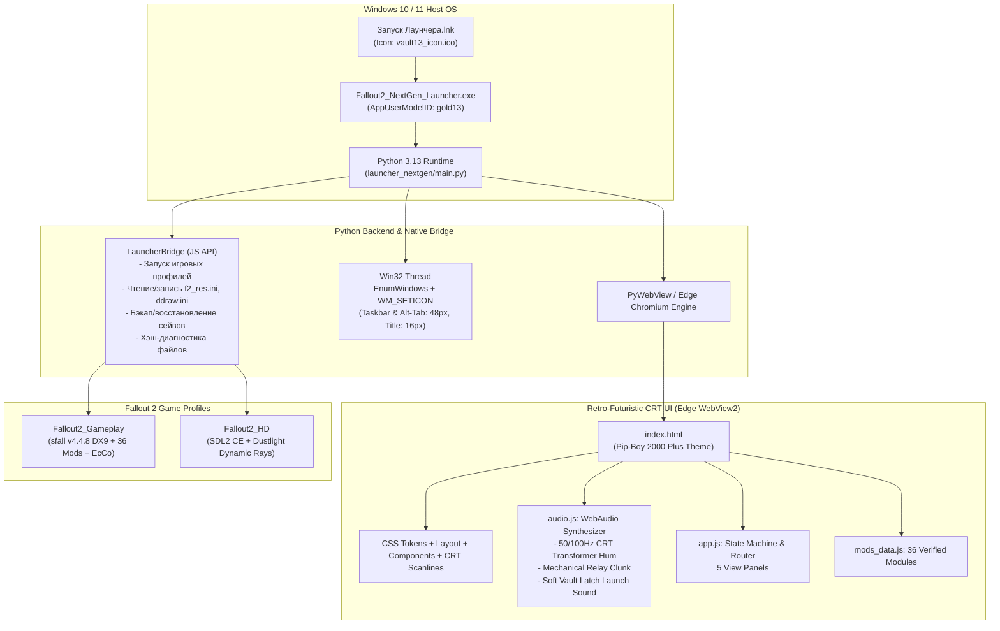

# ⚡ NEXTGEN LAUNCHER: ЭТАЛОННАЯ АРХИТЕКТУРНАЯ КАРТА & ДИЗАЙН-КОДЕКС (2026)
# FALLOUT 2: ULTIMATE WASTELAND EDITION // PIP-BOY 2000 PLUS

> **Статус документа:** Генеральный архитектурный стандарт, дизайн-система и неизменяемые инварианты лаунчера  
> **Роль:** Главный разработчик (Lead / CTO) и UI/UX Архитектор  
> **Исполняемый файл:** `Fallout2_NextGen_Launcher.exe` (Standalone PyInstaller PE-бинарник, x64)  
> **Движок интерфейса:** Microsoft Edge WebView2 (Chromium Embedded) + Native Win32 API  
> **Рабочие директории:**  
> - Исходный код лаунчера: `E:\FALLOUT Ult pjt\launcher_nextgen\`  
> - Скомпилированный бинарник проекта: `E:\FALLOUT Ult pjt\Fallout2_NextGen_Launcher.exe`  
> - Готовый клиент в игре: `E:\Fallout2_Ultimate\Fallout2_NextGen_Launcher.exe`  
> - Ярлык запуска: `E:\Fallout2_Ultimate\Запуск Лаунчера.lnk`  

---

## 1. СТРОГИЕ ИНВАРИАНТЫ ЛАУНЧЕРА (ЧТО ЗАПРЕЩЕНО ЛОМАТЬ)

Перед внесением **любых** изменений в код лаунчера разработчик (любой агент во всех чатах) **ОБЯЗАН** свериться с данным списком. Если правка нарушает хотя бы один пункт — она немедленно блокируется.

### 🛑 Золотые правила:
1. **Иконка приложения (Yellow Gear with 13):**
   - Строго золотая шестеренка Убежища 13 с темно-синей сердцевиной и золотой цифрой 13 (`vault13_navy_gold.png`).
   - Windows `.ico` обязан быть 7-слойным: `[16, 24, 32, 48, 64, 128, 256]` с 32-битным PNG-сжатием.
   - Идентификатор приложения `AppUserModelID` обязан быть: `"genix106.fallout2.ultimate.launcher.2026.gold13"`. Запрещено откатывать на `.green` (иначе Windows сбрасывает кэш таскбара в старый зеленый цвет).
   - Привязка иконки окна в `main.py` выполняется через перехватчик `EnumWindows` + `WM_SETICON` (0 для title bar, 1 для панели задач и Alt-Tab).
2. **Шапка лаунчера (Header Bar):**
   - Слева от `VAULT-TEC`: **Официальный векторный знак Vault-Tec** (`assets/vault_tec_emblem.svg`) с золотистым свечением. Никаких антенн, вышек или случайных иконок!
   - Внутри плашки `VAULT 13 // PIP-BOY 2000 PLUS`: иконка золотой шестеренки с цифрой 13 (`assets/vault13_icon.png`).
   - Заголовок окна в `<title>` HTML обязан строго совпадать с заголовком в Python: `Fallout 2 Ultimate Wasteland Edition 2026 // Pip-Boy 2000 Plus`.
3. **Блок быстрых настроек QoL (Zero Empty Space Rule):**
   - Настройки подсветки лута и врагов объединены в **единую двухколоночную карточку** `qol-unified-highlight-card` на всю ширину (`grid-column: 1 / -1`).
   - Запрещено делать асимметричные карточки, оставляющие пустые дыры в сетке.
4. **Каталог модов (16:9 Cinema Aspect Ratio):**
   - Постеры карточек модов имеют фиксированное соотношение сторон `aspect-ratio: 16 / 9` и `object-fit: cover`.
   - Заголовки карточек имеют `min-height: 38px` для сохранения единой горизонтальной линии сетки.
   - Футер карточки прижат к низу через `margin-top: auto`.
   - Запрещено использовать изображение автомобиля Хайвеймен для кумулятивного патча (`master_patch.png` — это отдельный арт серверной Убежища с лампами и терминалами).
5. **Аудио-система (WebAudio API Engine):**
   - Обязательно наличие разблокировщика `setupUserUnlock()` на события `pointerdown`/`keydown`/`click` для снятия блокировки автовоспроизведения в Chromium.
   - CRT-гул (`startCrtHum`): мягкий двухчастотный тон 50 Гц / 100 Гц с низкочастотным фильтром на 180 Гц и тихим катодным резонансом (gain ~0.022). Не должен утомлять слух.
   - Звук запуска игры (`playGameLaunch`): тяжелый гидравлический щелчок и закрытие гермозатвора (160 Гц -> 42 Гц, gain 0.22). Никаких громких визжащих сирен.
   - Звук старта лаунчера (`playLauncherBoot`): катодный импульс и двойное реле питания.
6. **Синхронизация директорий:**
   - Любое изменение в `E:\FALLOUT Ult pjt\launcher_nextgen\` обязано зеркалироваться в `E:\Fallout2_Ultimate\launcher_nextgen\`.
   - После изменения файлов выполняется компиляция чистого бинарника в `E:\FALLOUT Ult pjt\dist\Fallout2_NextGen_Launcher.exe` и копирование в обе директории.

---

## 2. АРХИТЕКТУРА И СТЕК ТЕХНОЛОГИЙ



---

## 3. ПОЛНАЯ КАРТА ЭКРАНОВ И ЭЛЕМЕНТОВ ИНТЕРФЕЙСА

### Экран 1: `[01] СТАТУС & ЗАПУСК` (`view-launch`)
* **Главный запуск:**
  * Кнопка 1: `▶ ЗАПУСК GAMEPLAY ULTIMATE` (Неоново-зеленый стиль, 2560x1440 2K, 36 модов, sfall 4.4.8).
  * Кнопка 2: `▶ ЗАПУСК REWORK HD` (Теплый янтарный стиль, каноничный SDL2 движок, динамический свет).
* **Блок быстрых настроек QoL (3 ряда, без пустот):**
  * Ряд 1: `[x] Всегда бегать (Auto-Run)` | `[x] Автоперезарядка оружия`
  * Ряд 2: **Единый блок тактической подсветки** (Loot Highlight Shift/Caps + Combat Target Highlight Dropdown).
  * Ряд 3: `[x] Линия видимости (CheckLOS)` | `[x] Закрытие инвентаря кликом вне окна`
* **Баннер диагностики:**
  * Индикатор целостности системы `[✓] СИСТЕМА ГОТОВА К ЗАПУСКУ`.
  * Кнопка `[>] ДИАГНОСТИКА ОКРУЖЕНИЯ` (переход в терминал проверки).

### Экран 2: `[02] КАТАЛОГ МОДОВ` (`view-catalog`)
* **Фильтры категорий:**
  * `ВСЕ (36 МОДОВ)`
  * `КВЕСТЫ И МИР`
  * `ВИЗУАЛ И АНИМАЦИИ`
  * `НАПАРНИКИ`
  * `ГЕЙМПЛЕЙ И QOL`
  * `КОМЬЮНИТИ (ФОКС)` — модуль Foxx ReBuild Community Pack с благодарностью автору.
  * `[!] В РАЗРАБОТКЕ / ТЕСТ` — оранжевый акцент: динамическое воровство, тактическая подсветка, клик вне окон, приказы спутникам.
  * `ЗВУК 44.1 КГЦ`, `ДВИЖОК И ЯДРО`, `ПЕРЕВОД 18+`.
  * Переключатель вида: `[▤] ПОСТЕРЫ: ВКЛ / СПИСОК`.
* **Карточка мода (Каноничный вид):**
  * Постер 16:9 (`assets/posters/{mod_id}.png`).
  * Бейдж категории + версия.
  * Заголовок мода (`min-height: 38px`).
  * Текст описания.
  * Блок `Отменяет: {баги_оригинала}`.
  * Футер: Автор + `Инфо ▹` (открытие модального окна).

### Экран 3: `[03] КОНФИГУРАЦИЯ` (`view-settings`)
* Разрешение экрана (1920x1080, 2560x1440, 3840x2160).
* Графический режим (Direct3D 9 / DirectDraw 7 / Software).
* Герцовка (60 / 120 / 144 / 240 Гц).
* Шейдеры четкости и ЭЛТ-развертки.
* Параметры звука и субтитров.

### Экран 4: `[04] АРХИВ СЕЙВОВ` (`view-saves`)
* Список слотов сохранений обоих профилей.
* Создание снапшота в 1 клик с временной меткой.
* Восстановление из архива.

### Экран 5: `[05] ТЕРМИНАЛ СВЯЗИ & ДИАГНОСТИКА` (`view-feedback`)
* Журнал системных событий и консольный вывод.
* Тест 16 ключевых компонентов (DAT2 архивы, DLL sfall, экзешники, шрифты).
* Статус дискового пространства и прав доступа.

---

## 4. СКИЛЛЫ ДЛЯ РАБОТЫ С ЛАУНЧЕРОМ

Каждый агент, работающий с лаунчером, должен активировать и применять следующие скиллы:

1. [`lead-developer`](file:///C:/Users/Геннадий/.gemini/config/skills/lead-developer/SKILL.md):
   * Контроль архитектурной целостности. Запрет на «костыли на коленке».
   * Неизменяемость проверенных компонентов.
2. [`fallout-audit-god`](file:///C:/Users/Геннадий/.gemini/config/skills/fallout-audit-god/SKILL.md):
   * Аудит VFS слоев, параметров `f2_res.ini`, `ddraw.ini` и бесконфликтность игровых профилей.
3. [`impeccable`](file:///C:/Users/Геннадий/.gemini/config/skills/impeccable/SKILL.md) & [`antislop-ui`](file:///C:/Users/Геннадий/.gemini/config/skills/antislop-ui/SKILL.md):
   * Строгая типографика, выравнивание сеток, идеальный контраст CRT-стиля, запрет визуального мусора.
4. [`powershell-windows-ops`](file:///C:/Users/Геннадий/.gemini/config/skills/powershell-windows-ops/SKILL.md):
   * Выполнение команд с принудительной UTF-8 кодировкой, экранирование путей с пробелами, сборка бинарника PyInstaller без зависаний.
5. [`continual-learning`](file:///C:/Users/Геннадий/.gemini/config/skills/continual-learning/SKILL.md):
   * Защита от повторения ошибок, проверка журнала перед изменениями.

---


### ⚠️ ЖЕЛЕЗНОЕ ПРАВИЛО СИНХРОНИЗАЦИИ ЭТАЛОННЫХ НАСТРОЕК (FIX-64)
> **КРИТИЧЕСКИ ВАЖНО ДЛЯ ВСЕХ АГЕНТОВ И РАЗРАБОТЧИКОВ:**
> Лаунчер Fallout2_NextGen_Launcher.exe при каждом запуске профиля или сохранении настроек вызывает метод LauncherBridge.save_config().
> **КАТЕГОРИЧЕСКИ ЗАПРЕЩЕНО** затирать или игнорировать каноничные инженерные параметры сборки. Метод save_config() ОБЯЗАН принудительно фиксировать:
> 1. o2tweaks.ini -> highlighting=0 (СТРОГО 0! Подсветка передана монопольно в gl_highlighting.int и gl_highlighting.ini для исключения двойного цикла и мерцания).
> 2. 2_res.ini -> EXTRA_WIN_MSG_CHECKS=1 (прокачка оконных сообщений), CPU_USAGE_FIX=0 (защита от двойного засыпания потока с sfall).
> 3. ddraw.ini -> LimitFPS=1 (или выбор FPS Lock), OverrideArtCacheSize=1 (261 МБ арт-кэш в RAM), AnimationsAtOnceLimit=64, TimeLimit=-3, AllowUnsafeScripting=2, EnableMusicInDialogue=1, ExpandInventory=1.
> **ПРАВИЛО РАЗРАБОТКИ:** Любая новая системная настройка INI ОБЯЗАНА сразу прописываться в словарях save_config() в launcher_nextgen/main.py с последующей пересборкой бинарника лаунчера через PyInstaller.

## 5. ПРОЦЕДУРА ВНЕСЕНИЯ ИЗМЕНЕНИЙ И ВЕРИФИКАЦИИ (CHECKLIST)

При любых правках лаунчера выполняется строгий протокол из 6 шагов:

```
[ ] ШАГ 1: Локальная правка в E:\FALLOUT Ult pjt\launcher_nextgen\
[ ] ШАГ 2: Проверка отсутствия сломанной верстки в браузере / WebView2
[ ] ШАГ 3: Зеркалирование файлов в E:\Fallout2_Ultimate\launcher_nextgen\
[ ] ШАГ 4: Компиляция бинарника:
           cd "E:\FALLOUT Ult pjt"; py -m PyInstaller Fallout2_NextGen_Launcher.spec --noconfirm --clean
[ ] ШАГ 5: Развертывание бинарника:
           Копирование Fallout2_NextGen_Launcher.exe в обе папки
[ ] ШАГ 6: Smoke Test:
           Тестовый запуск процесса на 3 секунды, проверка отсутствия вылетов,
           валидация извлеченной иконки через ExtractIconEx.
```

---

## 6. ЖУРНАЛ ВЕРСИЙ ЛАУНЧЕРА (CHANGELOG)

* **v2026.1 (23.11.2026):**
  * Внедрена каноничная золотая иконка «Шестеренка с 13» на панели задач Windows, в окне и ярлыке (`vault13_icon.ico` 7-in-1, `AppUserModelID: gold13`).
  * В шапке установлен официальный векторный логотип Vault-Tec (`vault_tec_emblem.svg`).
  * Полностью устранены пустые места в сетке QoL: объединена тактическая подсветка лута и врагов в одну симметричную карточку.
  * Заменен дубликат постера `master_patch.png` на концепт-арт мейнфрейма Убежища.
  * Созданы и подключены концепт-арты для модов Фокса и модов в разработке (`foxx_pack.png`, `dynamic_theft.png`, `qol_interface.png`, `tactical_highlight.png`).
  * Звуковая система переведена на глубокий механический затвор Убежища для запуска игры и мягкий старт катодной трубки лаунчера; восстановлен фоновый CRT-гул с обходом блокировки в WebView2.
