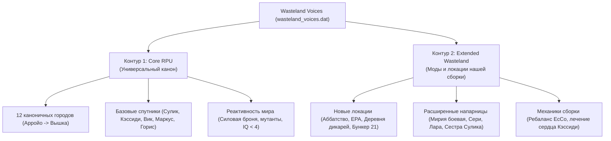

# 🗺️ КАРТА ПРОЕКТА // MASTER PROJECT MAP & PHILOSOPHY
# FALLOUT 2: ULTIMATE WASTELAND EDITION (2026)

> **Статус:** Генеральный документ архитектуры и философии проекта  
> **Версия:** Director's Cut 2026 (Ядро: RPU v2.4.34 / sfall v4.4.8 DX9 / SDL2 CE Dustlight v0.9.4-beta)  
> **Генеральный кодекс лора и канона 2241 года:** [FALLOUT_LORE_CANON.md](file:///E:/FALLOUT%20Ult%20pjt/FALLOUT_LORE_CANON.md)  
> **Полный подробный реестр изменений (Changelog):** [MASTER_CHANGELOG.md](file:///E:/FALLOUT%20Ult%20pjt/MASTER_CHANGELOG.md)  
> **Архитектурный аудит и дерево скиллов:** [AUDIT_FALLOUT_MODDING_ARCHITECTURE.md](file:///E:/FALLOUT%20Ult%20pjt/Docs/AUDIT_FALLOUT_MODDING_ARCHITECTURE.md)  
> **Главный разработчик (Lead/CTO):** Antigravity  
> **Заказчик и Product Owner:** Геннадий Лаптев  
> **Рабочая директория:** `E:\FALLOUT Ult pjt\`  
> **Дистрибутив игры:** `E:\Fallout2_Ultimate\`  

---

## 1. ФИЛОСОФИЯ СБОРКИ (МАНИФЕСТ ПРОЕКТА)

Сборка создается по жесткому инженерному и художественному стандарту. Наша цель — не очередной любительский пак, а **образцовое переиздание классического Fallout 2**, в которое хочется играть в 2026 году.

### Ключевые принципы:

1. **Максимальное расширение, но без бредятины (Zero Slop / Lore-Friendly):**
   * В игру возвращается весь вырезанный разработчиками каноничный контент, квесты и локации.
   * **Железный фильтр отсева:** никакого современного тактического оружия из Call of Duty, аниме-персонажей, шуточных мемов, неоновых текстур и ломающих баланс читерских предметов. Каждая деталь обязана выглядеть так, будто ее создали Black Isle Studios в 1998 году.
2. **Анти-Мегамод: никакого наваливания в кучу ради галочки:**
   * Старые фанатские сборки (вроде классического Megamod) страдали синдромом «свалки»: сотни сырых, нетестированных модов от разных авторов, которые конфликтовали между собой, ломали квесты и приводили к непроходимым софтлокам.
   * Наш подход — **хирургический отбор и монолитная интеграция**. Каждый модуль протестирован на бесконфликтность с остальными.
3. **Идеальный баланс и устранение сюжетных дыр (Closed-Loop Narrative):**
   * Мы не просто ставим моды — мы вручную исправляем застарелые сценарные тупики оригинала, где скрипты забывали забрать предмет, зависали в диалогах или делали союзников пассивными манекенами.
   * Полноценная поддержка отыгрыша: игрок с любыми характеристиками (включая персонажа с интеллектом 1–3) должен иметь логичные ветки диалогов и способы решения задач.
4. **Коммерческий стандарт «Out-of-the-Box» (Сел и играй):**
   * Никакого ручного ковыряния в файлах `.ini`, командной строке или подбора разрешений.
   * Установка в 1 клик через единый инсталлятор `Setup.exe`.
   * Нативная поддержка мониторов 1080p, 2K и 4K, субпиксельная мышь, честная герцовка 144–240 Гц без статтеров и зависаний на Windows 10/11 и видеокартах RTX / Radeon.
5. **Двухконтурная архитектура движков (Dual-Engine):**
   * Игроку дается два независимых профиля:
     - **Gameplay Ultimate** — максимальный контент на оригинальном расширенном движке sfall v4.4.8.
     - **Rework HD** — аутентичный канон на открытом C++ движке SDL2 с динамическим лучевым светом Dustlight.

---

## 2. ПОЛНЫЙ КАТАЛОГ И АНАЛИЗ ВКЛЮЧЕННЫХ МОДУЛЕЙ

Сборка объединяет **24 выверенных компонента**, разделенных по функциональным слоям:

### Слой 1: Сюжет, локации и квесты
* **Restoration Project Updated (RPU v28.0):**  
  *Авторы: Killap, Burn, Darek, BGforge.*  
  Масштабное восстановление вырезанных городов: монастырь Аббатство (The Abbey), Агентство охраны окружающей среды (EPA), Деревня Дикарей (Primitive Tribe), Лагерь Работорговцев в Дыре, тайное Убежище 23, встречи с Кагой.
* **Community Narrative Fixes 2026 (Наши авторские исправления):**  
  *Авторы: Antigravity & Геннадий Лаптев.*  
  Хирургическое устранение 7 ключевых сюжетных дыр:
  1. *Дыра — Смитти и Хайвеймен (`dcsmitty`):* снят софтлок при отдельной сдаче контроллера и денег.
  2. *Дыра — Джоуи и амулет призрака Анны (`dcjoey`):* амулет всегда можно вернуть (выкупом, силой или диалогом).
  3. *Модок — Часы Корнелиуса (`mccornel`, `mcfarrel`):* добавлены крысиные следы на часах, спор разрешается миром без крови.
  4. *Кламат — Братья Дантоны и Торр (`kctorr`, `kcdunton`):* Торр получил боевой AI с дубинкой (`TEAM_PLAYER`), а Дантоны — ветку запугивания при интеллекте 1–3.
  5. *Город Убежища — Доктор Трой и Джет (`vcdrtroy`):* снят запрет на исцеление дикарей, добавлена научная победа в споре о лекарстве от зависимости.
  6. *Нью-Рино — Багажник Т-Рея (`nctray`):* открыт апгрейд вместимости багажника даже при возврате машины силой.
  7. *Город Убежища — Сердце Джона Кэссиди (`vccasidy`):* внедрено полноценное медицинское лечение сердца у доктора Троя таблетками от стенокардии.
* **Miria Companion Expansion:**  
  *Автор: debrouxl, RPU.*  
  Превращает навязанного супруга (Мирию или Дэвина) из мертвого груза в полноценного соратника: команда «Жди здесь», прокачка уровней 1–6, инвентарь и возможность цивилизованного развода.

### Слой 2: Напарники и визуальная эволюция
* **NPC Armor Visual Evolution (B-Team):**  
  *Авторы: Continuum, Skynet, RPU.*  
  Спутники (Сулик, Вик, Мирия, Дэвин) визуально меняют свои спрайты в зависимости от надетой брони (кожаная куртка, боевая броня, силовая броня T-51b).
* **Super Mutant Marcus Armor & Dogmeat Kevlar:**  
  *Автор: Continuum.*  
  Тяжелая броня супермутантов для Маркуса и кевларовый бронежилет для Псины — напарники выживают в финальных схватках с патрулями Анклава.
* **John Cassidy Talking Head & HQ Voice:**  
  *Авторы: Joey Bracken, RPU Team.*  
  Живая анимированная 3D-голова бармена Джона Кэссиди с профессиональной актерской озвучкой 44.1 кГц.
* **Combat & Weapon Animations:**  
  *Автор: RPU Animation Team.*  
  Сотни новых кадров боевых спрайтов: охотничьи винтовки, вакидзаси, огнемет, дульные вспышки и корректная отдача.
* **Hero Appearance Customization:**  
  Возможность выбора внешности Избранного на старте (прическа, борода, цвет кожи).

### Слой 3: Звуковое окружение
* **Mark Morgan Lossless Remaster (1.0 ГБ):**  
  *Авторы: Mark Morgan, BGforge Net.*  
  Полная замена глухого сжатого моно 22 кГц эпохи 90-х на кристально чистый студийный стереозвук 44.1 кГц (31 оригинальный трек).
* **UPU Russian Sound Remaster:**  
  *Автор: Foxx, 1С Team.*  
  Исправление битых звуковых дорожек выстрелов и фоновых эффектов.

### Слой 4: Геймплей, тактика и удобство (QoL)
* **YAAM & Glovz Ballistics Overhaul:**  
  *Авторы: Glovz, YAAM.*  
  Исправление сломанной формулы урона оригинала: бронебойные патроны (AP) пробивают тяжелую броню, а экспансивные (JHP) эффективны по незащищенным целям.
* **F2MechanicsMiniRework & Wasteland Craft:**  
  *Автор: phobos2077, EcCo Team.*  
  Кустарный арсенал Пустоши (трубчатые самопалы, капканы, разделка дичи ножом на шкуры и мясо, готовка у костров Кламата и Арройо).
* **AutoDoors & Loot Preservation:**  
  *Автор: sfall team, BGforge.*  
  Автоматическое открытие дверей на пути бегущего героя и сохранение лута при критической дезинтеграции энергооружием.
* **Advanced Inventory Filter & Wheel Support:**  
  *Автор: Mr.Stalin.*  
  Прокрутка инвентаря колесиком мыши, быстрое перемещение вещей по клику, расширенный бартер на 4 слота и фильтры по типам предметов.
* **Glasses Mod & Eyewear Gear:**  
  *Автор: Foxx, sfall / Antigravity.*  
  Надевание солнцезащитных (+1 к Харизме) и оптических (+1 к Восприятию) очков непосредственно на силуэт персонажа или через контекстное меню инвентаря. Слоты оружия в руках остаются полностью свободными.
* **Last Stand & Tactical Combat AI:**  
  *Автор: Antigravity Engine Team.*  
  Устранение бесконечных погонь за ранеными: роботы, мутанты и когти смерти не бегут в панике; опытные рейдеры отступают на 12 гексов и ведут огонь с дистанции; тяжелораненые бойцы имеют редкий шанс (8–10%) впасть в ярость отчаяния и броситься в самоубийственную лобовую атаку с одной из 12 боевых фраз.
* **Party Orders Tactical Remote:**  
  *Автор: phobos2077.*  
  Быстрые тактические команды отряду в бою и на карте через горячие клавиши.
* **Highwayman Overhaul & Trunk Protection:**  
  Защита багажника машины от пропажи лута, турбонагнетатель Смитти и оптимизированный расход микроядерных батарей.
* **Curated Encounters & Worldmap Engine:**  
  Нормализация частоты случайных встреч на быстрых многоядерных процессорах и широкоформатная карта мира.
* **Fair Inventory AP & Action Economy:**  
  *Автор: Antigravity & phobos2077.*  
  Бесплатный вход в инвентарь для осмотра и оценки веса (0 ОД); честная трата ОД за использование медикаментов и перезарядку (2 ОД, 1 ОД с «Быстрыми карманами»).
* **Molotov Fire Damage & AoE:**  
  *Автор: NovaRain, Antigravity.*  
  Честный огненный урон коктейля Молотова (DMG_fire) с радиусом разлёта пламени в 2 гекса.
* **Tactical Line of Sight (CheckLOS):**  
  Прямая линия видимости при подсветке предметов и контейнеров — устранение читерского «рентгеновского зрения» сквозь капитальные стены бункеров.

### Слой 5: Системный фундамент и движки
* **sfall v4.4.8 Engine + LAA 4GB:**  
  Аппаратный рендерер Direct3D 9, расширение памяти до 4 ГБ, снятие лимита 30 кадров/с, Raw Input мыши, фикс `CheckLOS=0` против микрофризов.
* **Rework HD Community Edition (SDL2 + Dustlight):**  
  Второй независимый движок на чистом C++ с динамическим лучевым освещением от факелов/костров, субпиксельной плавностью камеры и нативным разрешением 2K/4K.

---

## 3. СРАВНИТЕЛЬНЫЙ АНАЛИЗ: СБОРКА ФОКСА (REBUILD BY FOXX) VS НАША ULTIMATE СБОРКА

> **Первоисточник:** Официальный файл изменений Фокса `foxx_full_changelog.txt` (Google Drive `1UgWjizQb-Ivig60tq13WDNcTQF_sY1OB`, актуальная версия `07.03.26` из официального сообщества `vk.com/rebuild_by_foxx`).

### 3.1. Что представляет собой сборка Фокса (Expansion Version / Fixed Edition):
Фокс — классический репакер-консерватор. Его ключевой принцип:
1. Взять готовую базу Killap RP (Restoration Project) и обновлять в ней технические библиотеки (sFall от Mr.Stalin до 5.1.5.0, sFall Configurator 2.8.5, Inventory Filter 2.3.1).
2. Накатывать поверх официальные патчи RPU от BGforge (v28–v34) и отдельные мелкие фиксы сообщества (скрипт сестры Сулика, ошибка при использовании монтировки от AleSiS, карты АЗОС).
3. **Строгий запрет на геймплейное вмешательство:** Фокс принципиально не трогает сюжетную логику оригинальных квестов 1998 года. Из-за этого все классические тупики Black Isle (Торр без оружия, отсутствие диалога с Дантонами на пастбище у низкоинтеллектуального персонажа, баги с Корнелиусом и Фаррелом) у него остаются нетронутыми.
4. **Компромиссы по звуку:** В версии 3.8 Фокс вырезал тяжелую музыку без сжатия (HQ от burner1024) из-за размера и заменил на легковесную LQ от egornovivan, а в версии от 29.04.25 удалил Sound Overhaul от Eledin («не оправдал ожидание»).
5. **Предупреждение игроку:** «! Установка дополнительных модов, на свой страх и риск !» — сборка монолитна и не имеет удобного графического лаунчера для переключения режимов.

---

### 3.2. Сравнительная матрица: ReBuild by Foxx vs Fallout 2 Ultimate 2026

| Параметр / Компонент | Сборка Фокса (07.03.26) | Fallout 2: Ultimate Wasteland (2026) | Наше инженерное преимущество |
| :--- | :--- | :--- | :--- |
| **Архитектура движка** | Один движок (модифицированный sFall DX9) | **Двухконтурная система (Dual-Engine):** sfall DX9 + SDL2 Community Edition (Dustlight 2D) | Возможность выбора: ультрамодифицированный геймплей либо чистый C++ рендеринг с динамическим лучевым светом. |
| **Сюжетные тупики Black Isle** | Не тронуты (Торр пассивен, Дантоны не имеют ветки с дикарем) | **Полностью исправлены (7 сюжетных дыр):** Торр сражается дубинкой, диалог Дантонов расширен, мирное решение спора часов Модока | Настоящий отыгрыш без софтлоков и нелогичного поведения NPC. |
| **Музыка и звук** | Облегченное LQ аудио (для экономии места в раздаче) | **Полный 1.0 ГБ Lossless Remaster Mark Morgan (44.1 кГц)** + HQ озвучка Джона Кэссиди (Joey Bracken) | Кристальный объемный стереозвук без глухоты и артефактов сжатия 90-х. |
| **Интерфейс запуска** | Стандартный `f2_res_Config.exe` и консольные bat-файлы | **NextGen Pip-Boy Launcher** (HTML/CSS/JS) с переключением CRT-сканлайнов, карточками модулей и музыкой | Премиальный коммерческий вид «из коробки», удобный запуск любого профиля. |
| **Графика и освещение** | Классический спрайтовый 2D свет 1998 года | **Динамическое освещение Dustlight (Rework HD)** с альбедо 2x/3x/4x и честными лучами от факелов/костров | Визуальное осовременивание игры уровня Disco Elysium без разрушения классической изометрии. |
| **Игровой лимит времени** | 50 лет (увеличен скриптом) | **Полное снятие лимита (`TimeLimit=-3`)** | Свободное бесконечное исследование Пустошей без угрозы внезапного Game Over. |
| **Установка и развертывание** | Обычный Inno Setup репак игры целиком | **Standalone Setup 2026 (~3.8–4.2 ГБ LZMA2 / 4.8 ГБ на диске)** с ярлыками, автонастройкой экранов и лаунчером | Разворачивается за 2 минуты на любой современной Windows 10/11. |

---

### 3.3. Наработки Фокса (ReBuild 2026) и Fallout 1.5: Resurrection (Fixed Edition)

Вся экосистема решений Фокса разделена на три четкие категории:

#### 1. Уже внедрено и работает в сборке:
1. **Alternative Explosions (`rpu_alternative_explosions.dat`):** Кинематографичные покадровые взрывы гранат, динамита, ракет и плазмы от художника Pixote.
2. **Glasses Mod & Eyewear Gear (`gl_glasses.ssl` / `gl_glasses.int`):** Наш собственный рукописный скрипт на базе sfall хуков. Надевание зеркальных (+1 ХР) и оптических (+1 ВС) очков перетаскиванием на силуэт персонажа (слот 8) или через «Использовать» без занятия слотов оружия. Защита от дюпа характеристик при снятии/выбросе (`HOOK_REMOVEINVENOBJ`).
3. **Широкоформатная адаптация интерфейса:** Аккуратные экраны бартера и диалогов без растягивания на 1280x720 / 1080p.
4. **Бесшовная автоперезарядка оружия после боя:** Интегрирована в ядро движка и выведена в отдельный переключатель в NextGen лаунчере.
5. **Снятие лимита времени (`TimeLimit=-3`):** Полное снятие ограничения 13 лет (у Фокса лишь продление до 50 лет).
6. **Фильтр инвентаря Mr.Stalin (`InventoryFilter.dat`):** Раскладка лута по категориям кнопками 1–7.
7. **Отображение брони на напарниках (`npc_armor.dat`):** Сулик, Вик, Кэссиди меняют спрайты под надетую броню.

#### 2. Гарантированно берем сразу («как есть / Plug & Play», P1):
1. **Тёмный фактурный интерфейс Resurrection (Dark Metal UI):**
   * *Компоненты:* Стилизованные под оружейную вороненую сталь экраны инвентаря (`INVENTRY.FRM`), бартера (`BARTER.FRM`, `TRADE.FRM`) и боковые накладки высокого разрешения.
   * *Интеграция:* Упаковка в автономный `mods/resurrection_interface.dat` с добавлением выбора темы оформления в NextGen лаунчер.
2. **Пакет из 4 скриптовых микрофиксов Фокса:**
   * `AleSiS Crowbar Fix` — устранение ошибки вылета при силовом взломе ящиков и дверей монтировкой.
   * `EPA Navmesh Fix` — исправленная сетка путей и гексов в АЗОС (спутники перестают застревать в стенах и лифтах).
   * `Sulik's Sister Final Check` — скриптовая проверка финала квеста спасения сестры Сулика, исключающая софтлок финальных титров.
   * `Cursed Dog Fix` — снятие штрафного перка «Проклятый», если собаку-неудачницу убивают напарники, а не сам игрок.
3. **Аудио-дополнение канона Black Isle 1998 года:**
   * `Unlocked Weapon Sounds 1.0` — 14 неиспользованных сэмплов выстрелов из оригинальных архивов Interplay 1998 года, дающих уникальный звук каждой стрелковой единице.

#### 3. Берем строго с хирургической доработкой и балансировкой (P2):
1. **RP Companion Expansion (версия 0.81.1) — Глубокие напарники:**
   * *Контент:* Сери (Seri) и Лара (Lara) из Дена становятся полноценными спутниками; глубокая сюжетная линия взросления и личных квестов Мирии (Miria) в Модоке.
   * *Что дорабатываем:*
     - Накладываем жесткий лимит найма по Харизме (`PartyLimit = Charisma / 2`), чтобы устранить баг найма армии спутников при Харизме 1.
     - Проводим перевод и адаптацию диалогов строго по нашему стандарту **Гибрида 1С + Фаргус**: техническая основа от 1С, но с сохранением дерзкого, язвительного уличного языка Пустошей («Фаргус») без ханжеской цензуры и канцелярита.
     - Вшиваем фикс сестры Сулика для исключения скриптовых накладок.
     - Прописываем напарникам уникальные ID для интеграции с боевыми приказами `Party Orders`.
2. **Tactical Lootable Armor (Тактическое снятие брони с трупов):**
   * *Контент:* Реалистичное выпадение нательной брони с убитых рейдеров и бойцов.
   * *Что дорабатываем:*
     - Привязка шанса к типу урона (огонь/плазма/взрывы = 0% дроп; пули = 5–15%; снайпинг в голову = 15–20%; рукопашный бой = 20–25%).
     - Состояние «разбито в хлам» (требует ремонта на верстаке EcCo и редких компонентов).
     - Гарантированное 100% сохранение штатного лута (оружие, патроны, стимпаки, крышки не страдают).
3. **Mades Redo Recipes (Походный крафт Пустоши):**
   * *Контент:* Изготовление походного снаряжения.
   * *Что дорабатываем:*
     - Отсев 80% читерского бреда (крафт энергооружия из хлама).
     - Сохранение ровно 20 лорных рецептов (заточка ножей/копий, бинты, переснаряжение охотничьих патронов).

---

### 3.4. Реестр внешних модов-кандидатов на доработку (External Candidate Register)
Полный технический аудит, категоризация и правила хирургической доработки кандидатов зафиксированы в специальном реестре:
👉 **[CANDIDATE_MODS_REGISTER.md](file:///d:/AG%20games%20mods/fallout2-ultimate-wasteland-2026/docs/CANDIDATE_MODS_REGISTER.md)**

Включает:
- **P1 (Берем сразу):** `Alternative Explosions`, `Unlocked Weapon Sounds 1.0`, `MapBlurFX`, фиксы Фокса (монтировка, сестра Сулика, сетка EPA).
- **P2 (Берем строго с доработкой):** `RP Companion Expansion 0.81.1` (лимит партии, вычитка текста), `Lootable Armor` (шанс 15–25%, износ), `Mades Redo Recipes` (только 20 лорных рецептов), `Bunker 21 & Truck` (ребаланс лута).
- **P3 (Исследование / Карантин):** `Scrapheap` (изоляция без Мегамода), `VaultVox`, `Carson City`, `Vault 14`.

---

## 4. ПРАВИЛА И ЗАПРЕТЫ ДЛЯ АГЕНТА ПРИ РАБОТЕ С ПРОЕКТОМ (INVARIANTS)

1. **Никакой отсебятины и треша:** Любая модификация или исправление обязаны гармонично вписываться в атмосферу Fallout 1 и Fallout 2.
2. **Всегда сверяться с этим файлом:** При добавлении любого мода, правке скрипта или обновлении интерфейса сначала проверять соответствие принципам из раздела 1.
3. **Closed-Loop верификация:** Любая правка компилируется в терминале, проверяется на запуск и фиксируется в Git.
4. **Безопасность диска C:** Все рабочие файлы, временные папки и дистрибутивы строго хранятся на дисках `D:\` и `E:\` (свободное место на диске C должно быть строго >10 ГБ).

---

## 5. R&D ЛАБОРАТОРИЯ: БАНК ИДЕЙ И ПЕРСПЕКТИВНЫХ МЕХАНИК

### 5.1. Бесшовная автоматическая перезарядка после боя (Smooth Post-Combat Auto-Reload)
* **Проблема кустарных реализаций:** Сторонние скрипты (например, в fo2tweaks) вешают перезарядку на мгновенный хук `HOOK_GAMEMODECHANGE`, принудительно обнуляют анимационные регистры (`reg_anim_clear`) и вызывают перерисовку интерфейса (`intface_redraw`) в тот самый миг, когда движок сам переключает экраны. Это приводит к рассинхрону DirectDraw/D3D9 буферов, сбросу полноэкранного фокуса и миганию панели задач Windows.
* **Каноничный инженерный стандарт:**
  1. **Отложенное выполнение (Deferred Execution):** Запуск процедуры через 3–5 тиков после полной стабилизации режима исследования (`combat_is_initialized == 0`).
  2. **Чистое манипулирование памятью:** Использование нативных sfall-опкодов `get_weapon_ammo_count`, `set_weapon_ammo_count` без сброса стека анимаций движка.
  3. **Аутентичный отклик:** Проигрывание звука затвора (`play_sfx`), вывод лаконичного сообщения в консоль Пип-Боя и естественное обновление счетчика патронов на панели.
  4. **Управление в лаунчере:** Наличие отдельного тумблера в настройках лаунчера (вкл/выкл по выбору игрока, аналогично автобегу).

### 5.2. Тактическое зрение, туман войны и сенсоры (Tactical Awareness & Fog-of-War)
* **Анализ провала скриптовой эмуляции поля зрения:** 
  Попытка скрыть криттеров скриптом через цикл каждые 10 кадров с вызовом `obj_blocking_line` ломает изометрический движок 1998 года: враги (например, радскорпионы в ночной пустыне) пропадают прямо перед глазами игрока, контуры мерцают при любом шаге, а постоянный `tile_refresh_display` вызывает микрофризы и дроп кадров.
* **Каноничный инженерный стандарт:**
  1. **Классический движок (sfall / DirectX 9):** 
     - Спрайты криттеров на карте не должны скрываться искусственными костылями (это ломает поиск путей и боевой ИИ).
     - Тактическая разведка строится вокруг **Сенсора движения (Motion Scanner)** и навыков Восприятия: прибор пеленгует цели за преградами, а в бою работает нативный высокоскоростной sfall C++ контурный рендер (120 FPS без скриптовых задержек).
  2. **Fallout Community Edition (CE) / Next-Gen:**
     - Настоящий туман войны реализуется исключительно на уровне GPU-шейдеров (радиальная маска видимости и освещения тайлов вокруг игрока), где скрытые зоны затемняются мягким градиентом, а не внезапным исчезновением сущностей.

### 5.3. Баланс скорости анимаций и вращения
* **Вращение персонажа в инвентаре:** Зафиксировано эталонное значение `SpeedInventoryPCRotation=300` в `ddraw.ini` (плавный, естественный разворот фигурки без эффекта юлы).
* **Боевой темп:** `combat_speed=85` в `fallout2.cfg` и `CombatPanelAnimDelay=90` в `ddraw.ini` обеспечивают отзывчивую стрельбу и мгновенную смену оружия без топорных пауз.
* **Частота стычек на глобальной карте:** `WorldMapEncounterRate=14` — балансирует темп путешествий между городами.

### 5.4. Ротация быстрого сохранения в лаунчере (Custom Multi-QuickSave Page)
* **Проблема потери прогресса и порчи ручных сейвов:**
  В классическом Fallout 2 быстрое сохранение по `F6` всегда перезаписывает ровно один слот. При случайном нажатии в бою или во время сбоя единственный файл повреждается. При этом слепое включение автосохранения на первые страницы затирает ручные контрольные сохранения игрока (первая страница для одного персонажа, вторая для другого).
* **Архитектурный стандарт лаунчера:**
  1. **Настраиваемая опция в GUI (QoL-панель):** Игрок сам выбирает режим работы быстрого сохранения из выпадающего списка:
     - `Выключено (1 слот по умолчанию)` → `AutoQuickSave=0` в `ddraw.ini`.
     - `Страница 7 (Слоты 70–79)` → `AutoQuickSave=1`, `AutoQuickSavePage=7` (10 циклических автосейвов на 7-й странице; страницы 8 и 9 остаются под ручные контрольные точки).
     - `Страница 9 (Слоты 90–99)` → `AutoQuickSave=1`, `AutoQuickSavePage=9` (максимально удаленная резервная страница).
  2. **Изоляция данных:** Защита ручных страниц 0..6 и 8 от любого вмешательства функции `F6`.
  3. **Доходчивое описание в интерфейсе:** Пояснение механизма ротации слотов без птичьего языка прямо под селектором в лаунчере.

---

## 6. АВТОНОМНЫЙ НАРРАТИВНЫЙ МОДУЛЬ: WASTELAND VOICES (ЖИВЫЕ ГОЛОСА ПУСТОШИ) v1.0.0

> 📜 **Сценарный стандарт:** [`fallout-narrative-craft`](file:///C:/Users/Геннадий/.gemini/config/skills/fallout-narrative-craft/SKILL.md)  
> 👥 **Речевые профили напарников:** [`companion-voices.md`](file:///C:/Users/Геннадий/.gemini/config/skills/fallout-narrative-craft/references/companion-voices.md)  
> 📐 **Матрица реплик и чек-лист:** [`replica-matrix.md`](file:///C:/Users/Геннадий/.gemini/config/skills/fallout-narrative-craft/references/replica-matrix.md)  
> 🧩 **Квестовая реактивность и реестр GVAR:** [QUEST_REACTIVITY_MATRIX.md](file:///E:/FALLOUT%20Ult%20pjt/standalone_mods/wasteland_voices/docs/QUEST_REACTIVITY_MATRIX.md)  
> 🏛️ **Архитектурный шаблон:** Спроектировано по стандарту `product-md-architect`.

### 6.1. Product Vision & Модульная концепция
**Wasteland Voices (Живые Голоса Пустоши)** разрабатывается как **самостоятельный изолированный мод (Standalone Mod)**, который:
1. Имеет собственный независимый репозиторий исходников в `standalone_mods/wasteland_voices/`.
2. Компилируется собственным сборочным конвейером `build.py` в отдельный архив `mods/wasteland_voices.dat`.
3. Подключается в VFS сборки через `mods_order.txt` без перезаписи оригинальных файлов игры.
4. Может распространяться как отдельный релиз для классического Fallout 2 / RPU на Nexus Mods.

### 6.2. Двухконтурная архитектура (Dual-Contour Engine)



### 6.3. Инженерные и сценарные инварианты (Black Isle 1998 Standard)
1. **Канон студии Black Isle Studios (Interplay Entertainment, 1998):**
   - Все тексты, тон и юмор пишутся в строгом соответствии с эстетикой создателей Fallout 2 (Тим Кейн, Крис Авеллон, Леонард Боярский, Джейсон Андерсон, Марк О'Грин).
   - *Пять правил канона:* черный виселичный юмор, бытовой цинизм выживания, глубокая социолектная разница между поселениями, эстетика ретро-футуризма 1950-х (без современного сленга и интернет-мемов), лаконичность (60–90 знаков на `float_msg`).
   - *Тест аутентичности:* Ни одна фраза не должна выдавать в себе фанатский мод — игра обязана ощущаться так, словно эти реплики были зашиты в дистрибутив Black Isle в 1998 году.
2. **Никакой перезаписи ванильных скриптов:**
   - Логика мода реализуется на независимых глобальных sfall-скриптах (`gl_wv_*.ssl`), которые работают поверх движка через хуки (`HOOK_STDPROCEDURE`, `HOOK_HEX_MOVE`).
3. **Изолированный пул диалогов (`wv_dialog.msg` / `custom.msg`):**
   - Тексты мода хранятся в собственном файле диалогов. Номера строк выделены в безопасный диапазон `{5000}+`, исключая любые пересечения с ванильными квестами.
4. **Динамическое зондирование карт (Map Safety Probe):**
   - Контур 2 проверяет наличие карт (`cur_map_index == MAP_ABBEY`, `MAP_EPA`). Если локация отсутствует (мод запущен на чистом RPU), скрипт спит и не вызывает ошибок `Error: [text not found]`.
5. **Конфигурация в один клик (`wasteland_voices.ini`):**
   - Игрок может независимо включать/отключать Контур 1 (`EnableCoreRPU=1`) и Контур 2 (`EnableExtendedMods=1`), а также настраивать кулдауны и вероятность реплик.
6. **Двуязычный паритет и кодировка:**
   - Русский текст: строго `Windows-1251 (CP1251)`. Английский текст: строго `ANSI/ASCII`.

### 6.4. Структура файлового дерева мода
```
standalone_mods/wasteland_voices/
├── PRODUCT.md                 # Генеральная спецификация мода
├── README.md                  # Описание, установка, чейнджлог
├── wasteland_voices.ini       # Пользовательский конфиг мода
├── build.py                   # Автономный упаковщик мода в .dat
├── scripts/                   # Исходные sFall SSL-скрипты
│   ├── gl_wv_core.ssl         # Логика Контура 1 (Core RPU)
│   └── gl_wv_extended.ssl     # Логика Контура 2 (Extended Wasteland)
├── text/
│   ├── russian/dialog/
│   │   └── wv_dialog.msg      # Русские тексты мода (CP1251)
│   └── english/dialog/
│       └── wv_dialog.msg      # Английские тексты мода (ANSI)
└── dist/
    └── wasteland_voices.dat   # Результирующий DAT-архив
```

### 6.5. Дорожная карта реализации (Roadmap / Autonomous Slices)
* **Срез 1 (Инфраструктура):** [ЗАВЕРШЕН] Развертывание директории `standalone_mods/wasteland_voices/`, создание `PRODUCT.md`, `wasteland_voices.ini`, каркаса `wv_dialog.msg` и сборочного скрипта `build.py`.
* **Срез 2 (Полный атлас 23 локаций: Small Talk и реплики жителей по клику):** [ЗАВЕРШЕН]
  - Охвачены все 23 обитаемые локации игры (15 Core RPU + 8 Extended Mod).
  - Сгенерирован полный корпус из 405 реплик на русском (CP1251) и английском (ANSI).
  - Написаны и скомпилированы sFall-скрипты `gl_wv_core.ssl` (3884 байт) и `gl_wv_extended.ssl` (3262 байт).
  - Собран DAT-архив `dist/wasteland_voices.dat` (78.8 КБ) в песочнице мода. Живая игра изолирована.
* **Срез 3 (Контур 1: Квестовая динамика и реактивность мира):** [ЗАВЕРШЕН]
  - Внедрен двухуровневый шлюз маршрутизации: Tier 0 (реактивность на игрока) -> Tier 1 (50% квестовые сплетни / 50% локальный быт).
  - Написаны и интегрированы реакции на силовую броню (T-51b/APA, `{5800-5809}`), обнаженные тяжелые пушки (миниганы, огнеметы, бозары, `{5830-5835}`), спутников-мутантов/гулей (Маркус, Ленни, Горис, `{5850-5857}`) и низкий интеллект (`IN < 4` / `dude_is_stupid`, `{5880-5886}`).
  - Реализован срез квестовой реактивности для всех городов канона (Арройо, Кламат, Дыра, Модок, Гекко, Город Убежища, Брокен Хиллс, Реддинг, Нью-Рино, НКР, Сан-Франциско, Убежище 15, Убежище 13, `{5500-5716}`) со строгой изоляцией городов (Strict City Scoping).
  - Общий объем корпуса достиг 580 строк (RU CP1251 / EN ASCII), сохранены строки тактики напарников sFall Party Tactics `{0..604}`.
  - Скомпилированы скрипты `gl_wv_core.int` (9320 байт) и `gl_wv_extended.int` (5498 байт).
  - Сформирован DAT-архив `dist/wasteland_voices.dat` (111.1 КБ, 6 файлов) в песочнице. Живые профили игры полностью нетронуты.
* **Срез 4 (Контур 2: Расширенный контент сборки):** Диалоги боевой Мирии, реактивность на бои EcCo и уникальные события расширенных модов.
* **Срез 5 (Сборка, аудит и деплой):** Финальное E2E тестирование в игре после согласования и одобрения пользователем.


