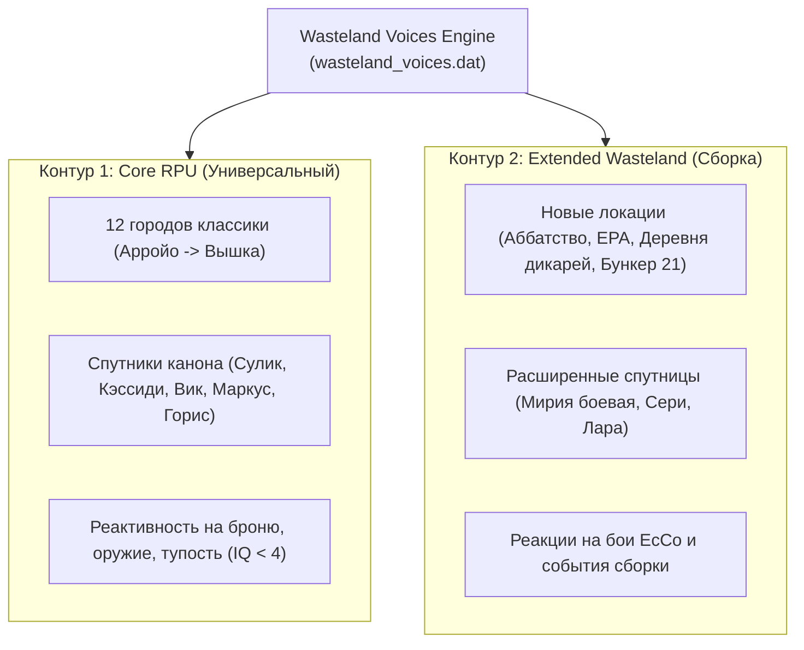

# 📜 PRODUCT BLUEPRINT & SPECIFICATION
# WASTELAND VOICES (ЖИВЫЕ ГОЛОСА ПУСТОШИ) v1.0.0

> 🧭 **Генеральная карта проекта:** [PROJECT_MAP.md](file:///E:/FALLOUT%20Ult%20pjt/PROJECT_MAP.md)  
> 📜 **Сценарный стандарт:** [`fallout-narrative-craft`](file:///C:/Users/Геннадий/.gemini/config/skills/fallout-narrative-craft/SKILL.md)  
> 👥 **Речевые профили:** [`companion-voices.md`](file:///C:/Users/Геннадий/.gemini/config/skills/fallout-narrative-craft/references/companion-voices.md)  
> 📐 **Матрица реплик:** [`replica-matrix.md`](file:///C:/Users/Геннадий/.gemini/config/skills/fallout-narrative-craft/references/replica-matrix.md)  
> 🧩 **Квестовая реактивность и реестр GVAR:** [QUEST_REACTIVITY_MATRIX.md](file:///E:/FALLOUT%20Ult%20pjt/standalone_mods/wasteland_voices/docs/QUEST_REACTIVITY_MATRIX.md)  
> 🏛️ **Архитектурный стандарт:** `product-md-architect`  

---

## 1. Product Vision & Executive Summary

### 1.1. Суть продукта
**Wasteland Voices (Живые Голоса Пустоши)** — это автономный нарративный модуль нового поколения для Fallout 2 (RPU 2.4.x / Ultimate Wasteland Edition). Мод оживляет мир игры через контекстные фоновые реплики (`float_msg`), живые словесные реакции напарников на локации и события, а также острую реактивность окружения на экипировку, карму и интеллект Избранного.

### 1.2. Проблема (Core Pain)
В оригинальном Fallout 2 мир часто кажется безмолвным и статичным:
- Напарники (Кэссиди, Сулик, Вик, Мирия) молча бегают за игроком сотни километров и никак не комментируют происходящее.
- Горожане слабо реагируют на то, что перед ними стоит двухметровый супермутант Маркус или ходячий танк в броне Анклава.
- Большинство фанатских модов на диалоги скатываются в безграмотный фанфикшн, ломают сейвы сдвигом строк в ванильных `.msg` или забивают экран спамом текста каждые 10 секунд.

### 1.3. Решение
Мод устраняет этот вакуум по каноничным стандартам Black Isle Studios 1998 года, используя безопасные хуки sFall и изолированное хранилище строк.

---

## 2. Architecture & Mental Model

### 2.1. Двухконтурная схема (Dual-Contour Architecture)



### 2.2. Системные инварианты
1. **Zero-Crash / Non-Invasive:** Никаких правок ванильных скриптов. Вся логика вынесена в глобальные sfall-скрипты `gl_wv_*.ssl`.
2. **Append-Only Range:** Собственный `.msg` файл, строки начинаются строго с `{5000}+`.
3. **Map Safety Probe:** Проверка наличия карт перед исполнением реплик Контура 2 (`cur_map_index`).
4. **Throttle & Cooldown:** Интервал между репликами не менее 60–120 секунд; шанс срабатывания 15–20%; не более одного говорящего на экране.
5. **Двуязычный паритет:** 100% RU (CP1251) + 100% EN (ANSI).

---

## 3. Сценарный канон Black Isle Studios (1998): ДНК стиля и фильтр фанатского мусора

Разработка текстов мода ведется строго по канону студии **Black Isle Studios** (подразделение **Interplay Entertainment**, авторы оригинального Fallout 2: Тим Кейн, Леонард Боярский, Крис Авеллон, Джейсон Андерсон, Марк О'Грин).

### 3.1. Пять столпов стиля Black Isle Studios
1. **Виселичная ирония и приземленный цинизм (Gallows Humor & Deadpan Cynicism):**
   - В Пустоши никто не произносит пафосных монологов о спасении мира. Люди выживают, считают гроши, жалуются на цингу, ревматизм, прохудившиеся подошвы и разбавленный самогон.
2. **Экономическая и бытовая достоверность (Economic & Physical Realism):**
   - Каждая фраза привязана к конкретной проблеме поселения: пересохший колодец, поломка генератора, цены на патроны у перекупщиков, пыль на зубах, застрявший рудный подъемник, налоги Республики.
3. **Социолекты и языковая дифференциация локаций (No Homogenized Speech):**
   - Никакого «усредненного языка». У каждого поселения свой словарь:
     - *Дикари (Арройо, Племя):* образный язык духов, предков, засухи, кремния и костяных крючков.
     - *Шахтеры (Реддинг, Брокен Хиллс):* кварцевый кашель, забой, уран, поножовщина за рулеткой, Джет.
     - *Снобы (Город Убежища):* термины генетической чистоты, стерильности, презрение к «чужакам».
     - *Мафия (Нью-Рино):* палп-сленг 1930-х годов, похоронные конторы, томми-ганы, наркота и продажные чиновники.
     - *Военные (Наварро, Анклав):* уставной лай, сержант Дорнан, регламенты, запах авиакеросина и плазменных батарей.
     - *Монахи (Аббатство):* скрипторий, чернила из сажи, благословение знаний, старинное вино.
4. **Ретро-футуристический фильтр 1950-х (Zero Anachronisms):**
   - Полный запрет на современный сленг («кринж», «душный», «имба»), интернет-мемы, мета-юмор и бесездовские ретконы. Мир застыл в эстетике американской научной фантастики 1950-х, перемолотой ядерной катастрофой.
5. **Формат реплик над головой (Float Standard):**
   - Длина строки строго 60–90 символов. Фраза обязана считываться игроком за 2–3 секунды над головой спрайта без необходимости открывать диалоговое окно.

---

## 4. Реестр локационных идей и речевых кодов (23 локации)

### Контур 1: Каноничные хабы RPU
* **Арройо (0):** Засуха, высыхающий колодец, ядовитые муравьи в ущелье, затупившиеся костяные копья, увядающий цветок брока, тотемы Священного 13.
* **Кламат (2):** Охота на гекко, самогонный куб Боба, болотные клещи, жуколюди Торра, шулерские кости братьев Дантонов, вонь мыла из бани.
* **Дыра (1):** Ломка от Джета, карманники Флика, вышибалы Мецгера, делящие склад банды Лары и Тайлера, разбавленный виски Фрэнки.
* **Модок (3):** Сухая земля, вонь кожевенной мастерской Бальтазара, забой скота Гришема, байки о светящихся мертвецах на Призрачной Ферме.
* **Город Убежища (4):** Биометрия, высокомерие Первого Гражданина Линетт, Авто-Док доктора Троя, презрение к беженцам в палатках Пригорода.
* **Гекко (5):** Давление в третьем контуре Реактора 5, уважение к Гарольду и его дереву, отслаивающаяся от радиации кожа, запчасти у Скитера.
* **Брокен Хиллс (6):** Поломка очистителя воздуха в шахте, хрупкий мир людей и супермутантов Маркуса, воспоминания мутантов о Создателе, рудные караваны.
* **Реддинг (7):** Золотая пыль в легких, война рудников «Кокавин» и «Утренняя Звезда», винтовые припадки забойщиков, шериф Марион.
* **Нью-Рино (8):** Семьи Сальваторе, Мордино, Райт и Бишоп; лазерные карабины, порностудии братьев Корсиканцев, похоронные конторы.
* **НКР (10):** Закон о запрете оружия, налоги Сената, президент Танди, бароны браминов Вестин и Карлсон, рейды Рейнджеров против работорговцев.
* **Убежище 15 (9):** Нищета сквоттеров на скалах, сломанный генератор, подозрения к шпионам Республики, рейдеры Дариона в глубине пещер.
* **Убежище 13 (11):** Разумные когти смерти Грутара, сгоревший модуль распознавания речи компьютера, детеныши в библиотеке Убежища.
* **Сан-Франциско (14):** Мудрость кремниевого Императора Ши, биологическое топливо, пьяные панки на танкере «Валдез», дзета-сканирование Хабологов.
* **Наварро (15):** Армейская муштра Анклава, разносы сержанта Дорнана, ремонт турбин винтокрылов, паранойя перед разведчиками НКР.
* **Вышка Анклава (16):** Вирус ВРЭ доктора Керлинга, речи президента Ричардсона, поступь Фрэнка Хорригана, сеть PoseidoNet.

### Контур 2: Восстановленные и добавленные локации
* **Аббатство (17):** Переписывание томов сажей и клеем, обет благоговения перед наукой, погребное вино, колокол заутрени.
* **Деревня дикарей (18):** Приливы океана, костяные гарпуны, шаманский дым водорослей, уход Сулика на поиски сестры, страх работорговцев.
* **EPA (19):** Мутагенные споры сектора B, сбои крио-сна, голограммы службы уборки с 2077 года, заклинившие лифты.
* **Деревня Убежища (49):** Запуганные патрулями Линетт крестьяне, ручные кротокрысы на грядках с репой, староста Коннар.
* **Конюшни Нью-Рино (48):** Подопытные наркоманы Майрона, запах аммиака из загонов браминов, выброшенные тела во рву.
* **Лагерь работорговцев (50):** Растертые кандалами щиколотки, надсмотрщики с дробовиками, цены на дикарей в Дыре, собаки у проволоки.
* **Базы Рейнджеров (52-54):** Охотничьи карабины с оптикой на 300 ярдов, засады на конвои работорговцев, скрытность в каньонах.
* **Подлодка Сан-Франциско (58):** Ржавчина на переборках «Шихуанди», заклинившие торпеды, вечный приказ политрука, конденсат.

---

## 5. Storage & VFS Schema

```
standalone_mods/wasteland_voices/
├── PRODUCT.md                 # Этот документ
├── README.md                  # Руководство пользователя
├── wasteland_voices.ini       # Конфигурационный файл
├── build.py                   # Автономный сборщик мода в .dat
├── scripts/
│   ├── gl_wv_core.ssl         # Скрипт Контура 1 (Core RPU)
│   └── gl_wv_extended.ssl     # Скрипт Контура 2 (Extended Wasteland)
├── text/
│   ├── russian/dialog/
│   │   └── wv_dialog.msg      # Русский текст (Windows-1251)
│   └── english/dialog/
│       └── wv_dialog.msg      # Английский текст (ANSI)
└── dist/
    └── wasteland_voices.dat   # Результирующий VFS-архив
```

---

## 6. Конфигурационная спецификация (`wasteland_voices.ini`)

```ini
[General]
EnableMod = 1             ; Общий переключатель мода (1 - вкл, 0 - выкл)
MinCooldownSeconds = 90   ; Минимальный интервал между фоновыми репликами
RNGChance = 20            ; Вероятность срабатывания при наступлении триггера (%)

[Modules]
EnableCoreRPU = 1         ; Контур 1: Ванильные города и спутники RPU
EnableExtendedMods = 1    ; Контур 2: Новые локации (EPA, Abbey, Tribe) и спутницы

[Reactivity]
ReactToPowerArmor = 1     ; Реакция прохожих на силовую броню
ReactToHeavyWeapons = 1   ; Реакция стражи на обнаженные пулеметы и огнеметы
ReactToCompanions = 1     ; Реакция толпы на мутанта Маркуса и гуля Ленни
ReactToLowIQ = 1          ; Особые реплики при интеллекте Избранного < 4
```

---

## 7. Дорожная карта срезов реализации (Slices for /goal)

### Срез 1: Инфраструктурный каркас (Завершен)
- [x] Создана архитектура и зафиксирована в [PROJECT_MAP.md](file:///E:/FALLOUT%20Ult%20pjt/PROJECT_MAP.md).
- [x] Развернута рабочая директория `standalone_mods/wasteland_voices/`.
- [x] Написан и верифицирован автономный упаковщик `build.py` (компиляция `.ssl`, сборка DAT2, деплой).
- [x] Создан конфигурационный файл `wasteland_voices.ini`.
- [x] Созданы языковые таблицы `wv_dialog.msg` и `custom.msg` (RU CP1251 / EN ANSI).
- [x] Созданы базовые скрипты `gl_wv_core.ssl` и `gl_wv_extended.ssl`, успешно скомпилированы в `.int`.
- [x] Протестирована сквозная сборка и развертывание в оба профиля (`Fallout2_Gameplay`, `Fallout2_HD`).

### Срез 2: Контур 1 и Контур 2 — Полный атлас всех локаций пустоши (Завершен)
- [x] Охвачены **все 23 обитаемые локации** игры (15 каноничных хабов RPU + 8 расширенных модовых локаций).
- [x] Составлен и реализован сценарный корпус из **405 уникальных реплик** (Small Talk / клик-реплики жителей):
  - **Контур 1 (Core RPU, 15 локаций, 265 реплик):** Арройо (20), Кламат (16), Дыра (16), Модок (16), Город Убежища (16), Гекко (16), Брокен Хиллс (20), Реддинг (16), Нью-Рино (16), НКР (20), Убежище 15 (16), Убежище 13 (16), Сан-Франциско (26), Наварро (20), Вышка Анклава (16).
  - **Контур 2 (Extended Mod, 8 локаций, 136 реплик):** Аббатство (20), Деревня первобытного племени (20), EPA (16), Деревня Убежища (16), Конюшни Нью-Рино (16), Лагерь работорговцев (16), Базы Рейнджеров (16), Подлодка Сан-Франциско (16).
- [x] Стопроцентный двуязычный паритет: русский текст (`Windows-1251`) и зеркальный английский (`ANSI`).
- [x] Оба скрипта (`gl_wv_core.ssl` и `gl_wv_extended.ssl`) перехватывают клики по рядовым горожанам, дикарям, шахтерам, панкам и монахам через sFall-хук `HOOK_STDPROCEDURE` (`talk_proc`), заменяя ванильные заезженные фразы.
- [x] Автоматическое определение текущей локации через нативный `cur_town`.
- [x] Оба скрипта перекомпилированы в `gl_wv_core.int` (3884 байт) и `gl_wv_extended.int` (3262 байт).
- [x] Результирующий архив `dist/wasteland_voices.dat` пересобран в песочнице (78.8 КБ). Живые профили игры остаются нетронутыми до согласования с пользователем.

### Срез 3: Контур 1 — Реактивность мира и квестовая динамика (Завершен)
- [x] Реплики горожан на силовую броню (T-51b / Advanced Power Armor) `{5800-5809}`.
- [x] Реплики охраны и прохожих на обнаженное тяжелое оружие в руках (миниганы, огнеметы, бозары, ракетницы) `{5830-5835}`.
- [x] Реакции на супермутанта Маркуса, гуля Ленни и когтя смерти Гориса в отряде `{5850-5857}`.
- [x] Реакции на низкий интеллект героя (`IN < 4` / `dude_is_stupid`) `{5880-5886}`.
- [x] Полная квестовая реактивность (Quest State Reactivity) по всем ключевым городам (Арройо, Кламат, Дыра, Модок, Гекко, Город Убежища, Брокен Хиллс, Реддинг, Нью-Рино, НКР, Сан-Франциско, Убежище 15, Убежище 13) `{5500-5716}`.
- [x] Двухуровневая модель маршрутизации реплик (Tier 0: Player Reactivity -> Tier 1: 50% Quest State vs 50% Local Small Talk).
- [x] Полная изоляция от перекрестного загрязнения городов (Strict City Scoping через `cur_town`).
- [x] Общий объем корпуса достиг **580 строк** (RU CP1251 / EN ASCII), сохранены строки тактики напарников sFall Party Tactics `{0..604}`.
- [x] Скрипты `gl_wv_core.ssl` и `gl_wv_extended.ssl` скомпилированы в `gl_wv_core.int` (9320 байт) и `gl_wv_extended.int` (5498 байт).
- [x] Результирующий архив `dist/wasteland_voices.dat` пересобран (111,093 байт, 6 файлов). Живые игровые профили полностью изолированы.

### Срез 4: Контур 2 — Расширенные локации и спутницы (Extended Wasteland) (Завершен)
- [x] Квестовая реактивность на расширенных локациях (Extended Quest Reactivity):
  - **Аббатство (The Abbey):** починка насоса `{5730-5732}`, уничтожение твари в винном погребе `{5733-5735}`, восстановление печатного станка и древних фолиантов `{5736-5738}`.
  - **Деревня дикарей (Primitive Tribe):** чистая вода в колодце `{5740-5742}`, спасение сестры Сулика Куранны `{5743-5745}`, изгнание торговца оружием `{5746-5748}`.
  - **EPA (Экологическое агентство):** истребление растений-людоедов `{5750-5752}`, освобождение крио-пленников и рабов комплекса `{5753-5755}`.
  - **Деревня Убежища (Vault Village):** поставка карабинов Коннару и защита от патрулей Линетт `{5760-5763}`.
  - **Лагерь работорговцев (Slaver Camp):** разгром лагеря и сброшенные ошейники `{5770-5773}`.
  - **Базы Рейнджеров (Ranger Safe Houses):** засады на конвои работорговцев Мецгера `{5775-5778}`.
- [x] Расширенная Мирия (Enhanced Miria City & Travel Reactivity):
  - Полноценные живые комментарии спутницы при посещении ключевых городов (Нью-Рино `{5900-5903}`, Город Убежища `{5904-5907}`, Ден `{5908-5911}`, Модок `{5912-5915}`, Кламат `{5916-5919}`, Сан-Франциско `{5920-5923}`, Брокен Хиллс `{5924-5927}`, Реддинг `{5928-5931}`, Аббатство `{5932-5934}`, EPA `{5935-5937}`, Племя `{5938-5940}`, Пустошь `{5941-5945}`).
  - Не блокирует диалоги и запускается через `map_enter_p_proc` со сменой города.
- [x] Боевая реактивность спутников (Companion Combat Shouts):
  - Перехват `HOOK_COMBATDAMAGE` в `gl_wv_core.ssl`: реакция союзников (Сулик, Вик, Кэссиди, Мирия, Маркус) на критическое ранение Избранного (`dude_cur_hp < dude_max_hp / 4`) `{5950-5964}`.
  - Боевые кличи при сокрушительных критических попаданиях напарников `{5970-5984}`.
- [x] Общий объем корпуса достиг **692 строк** (RU CP1251 / EN ANSI), сохранены строки тактики напарников sFall Party Tactics `{0..604}`.
- [x] Скрипты скомпилированы в `gl_wv_core.int` (11,106 байт) и `gl_wv_extended.int` (8,108 байт).
- [x] Собран обновленный DAT-архив `dist/wasteland_voices.dat` (133.9 КБ, 6 файлов).

### Срез 5: Сборка, упаковка и E2E валидация
- [ ] Компиляция `.ssl` через компилятор sFall в `.int`.
- [ ] Упаковка DAT-архива скриптом `build.py`.
- [ ] Проверка в обоих профилях игры (`Fallout2_Gameplay`, `Fallout2_HD`).
- [ ] Проверка двуязычного паритета и валидация лога `debug.log`.
